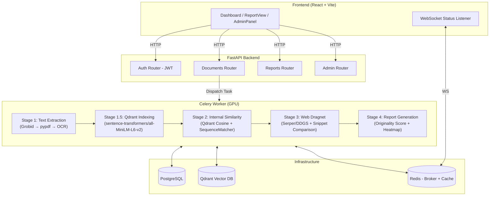
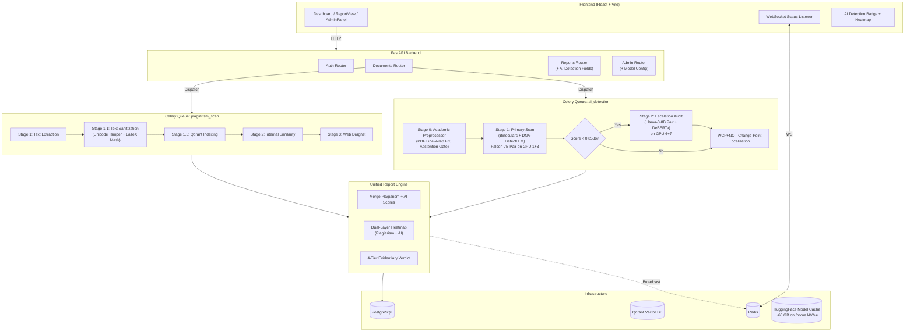

# Alethian Architecture Comparison: v2.0 (Current) → v3.0 (AI Detection)

**Author:** AI Systems Engineering  
**Date:** 2026-11-22  
**Status:** Architectural Specification — Pre-Implementation  

---

## 1. Executive Summary

Alethian v2.0 is a **plagiarism-only** academic integrity checker built on semantic vector search and web scraping. Alethian v3.0 extends this into a **unified Academic Integrity Platform** that also detects AI-generated text using zero-training statistical methods running on the same DGX GPU cluster.

The key architectural principle: **plagiarism detection and AI detection are orthogonal analysis dimensions** that share the same ingestion pipeline but diverge at the analysis stage and converge again at the unified report.

---

## 2. Current Architecture (Alethian v2.0)

### 2.1 System Topology



### 2.2 Current Processing Pipeline (Linear)

| Stage | Module | Function | Hardware |
| :--- | :--- | :--- | :--- |
| **1. Ingestion** | `text_extraction.py` | 3-tier PDF→text (Grobid→pypdf→OCR) | CPU |
| **1.5. Indexing** | `similarity.py` → `shingling.py` → `embeddings.py` | Sliding-window chunking, batch embedding (MiniLM-L6-v2, 384d), Qdrant upsert | GPU 4 (shared) |
| **2. Internal Similarity** | `similarity.py` | Exact search (cosine ≥ 0.95), Semantic search (cosine ≥ 0.85), SequenceMatcher verification | GPU 4 (shared) |
| **3. Web Dragnet** | `web_dragnet.py` → `content_fetcher.py` | Select suspicious chunks, Serper/DDGS search, snippet comparison | CPU + Network |
| **4. Report** | `report_engine.py` | `calculate_originality()`, `generate_heatmap()`, persist to PostgreSQL | CPU |

### 2.3 Current Module Inventory

```
Alethian/backend/app/
├── api/
│   ├── auth.py              # JWT login/register
│   ├── documents.py         # Upload, list, delete
│   ├── reports.py           # Report CRUD, export, review
│   ├── admin.py             # Config management
│   └── dependencies.py      # Auth middleware
├── core/
│   ├── config.py            # Pydantic Settings
│   ├── text_extraction.py   # 3-tier PDF parser
│   ├── ingestion.py         # GrobidClient
│   ├── shingling.py         # Sliding window + MIN_REAL_WORDS filter
│   ├── embeddings.py        # SentenceTransformer wrapper
│   ├── similarity.py        # QdrantManager, run_similarity(), index_document()
│   ├── web_dragnet.py       # SerperClient, run_dragnet()
│   ├── content_fetcher.py   # HTTP page fetch, snippet comparison
│   ├── report_engine.py     # Scoring, heatmap, stats
│   ├── rate_limit.py        # Rate limiter
│   ├── logging.py           # Logger config
│   └── exceptions.py        # Custom exceptions
├── db/
│   ├── models.py            # SQLAlchemy ORM (Document, Report, Match, Source, etc.)
│   └── session.py           # DB session factory
└── schemas/                 # Pydantic request/response models
```

### 2.4 Known v2.0 Deficiencies (Diagnosed, Not Yet Fixed)

| Issue | Root Cause | Impact |
| :--- | :--- | :--- |
| **52% score on identical twin** | `calculate_originality()` uses `total_matched_chars / 6.0` and `doc.content.split()` counts TOC dots as words | Severe under-reporting on theses with large TOCs |
| **All-red heatmap** | `generate_heatmap()` sums sliding-window word counts without interval merging → 200–500% overcounting | No visual differentiation between pages |
| **Print yields 1 page** | CSS `h-screen` + `overflow-hidden` traps content; no `@media print` rules | Unusable browser print |
| **Serper key not persisted** | `admin.py` PATCH handler ignores `serper_api_key` field | API key lost on restart |

---

## 3. Proposed Architecture (Alethian v3.0)

### 3.1 System Topology



### 3.2 Processing Pipeline Comparison

````carousel
### v2.0 Pipeline (Current — Plagiarism Only)

```
PDF Upload
    │
    ▼
[Stage 1] Text Extraction (Grobid → pypdf → OCR)
    │
    ▼
[Stage 1.5] Embedding + Qdrant Indexing (MiniLM-L6-v2)
    │
    ▼
[Stage 2] Internal Similarity (Qdrant cosine search)
    │
    ▼
[Stage 3] Web Dragnet (Serper / DDGS snippet search)
    │
    ▼
[Stage 4] Report: Originality Score + Heatmap
    │
    ▼
✅ Single Dimension: "Plagiarism Score" (0–100%)
```

<!-- slide -->

### v3.0 Pipeline (Proposed — Unified Integrity Platform)

```
PDF Upload
    │
    ├──────────────────────┐
    ▼                      ▼
[PLAGIARISM TRACK]    [AI DETECTION TRACK]
    │                      │
[S1] Text Extraction  [S0] Text Sanitization
    │                  (Unicode Tamper Gate,
[S1.1] Sanitize        LaTeX/Math Masking,
    │                   Line-Wrap Normalization,
[S1.5] Qdrant Index    Abstention Gate <150 tok)
    │                      │
[S2] Internal Sim     [S1-AI] Binoculars + DNA-DetectLLM
    │                  (Falcon-7B Pair, FP16, GPU 1+3)
[S3] Web Dragnet           │
    │                 [Decision] Score ≥ 0.9015?
    │                      │ No
    │                 [S2-AI] Escalation Audit
    │                  (Llama-3-8B + DeBERTa, GPU 6+7)
    │                      │
    │                 [Localize] WCP+NOT Change-Points
    │                      │
    └──────────┬───────────┘
               ▼
    [UNIFIED REPORT ENGINE]
     • Plagiarism Score (0–100%)
     • AI Detection Tier (T0–T3)
     • Dual-Layer Heatmap
     • 4-Tier Evidentiary Verdict
```
````

### 3.3 GPU Allocation Map (8 × V100-SXM2 32GB)

| GPU | Current Use (v2.0) | Proposed Use (v3.0) |
| :--- | :--- | :--- |
| **GPU 0** | External user workload (~2 GB) | External (unchanged) |
| **GPU 1** | **Idle** (6 MB) | **Falcon-7B Observer** (FP16, ~14 GB) |
| **GPU 2** | External workload (~16 GB) | External (unchanged) |
| **GPU 3** | **Idle** (4 MB) | **Falcon-7B-Instruct Performer** (FP16, ~14 GB) |
| **GPU 4** | Alethian Celery Worker (~6 MB idle) | Alethian Plagiarism Worker (unchanged) |
| **GPU 5** | External workload (~16 GB) | External (unchanged) |
| **GPU 6** | **Idle** (4 MB) | **Llama-3-8B Observer** (FP16, ~16 GB) — Stage 2 Escalation |
| **GPU 7** | **Idle** (8 MB) | **Llama-3-8B-Instruct** (FP16, ~16 GB) + **DeBERTa-v3** (FP32, ~1.4 GB) — Stage 2 |

### 3.4 New Modules to Create

```
Alethian/backend/app/
├── core/
│   ├── ai_detection/                    # NEW PACKAGE
│   │   ├── __init__.py
│   │   ├── preprocessor.py              # Stage 0: Unicode tamper, LaTeX masking, abstention
│   │   ├── binoculars.py                # Stage 1: Binoculars metric (Falcon-7B pair)
│   │   ├── dna_detect.py                # Stage 1: DNA-DetectLLM (zero-cost addon from same logits)
│   │   ├── escalation.py                # Stage 2: Llama-3-8B pair + DeBERTa corroborator
│   │   ├── localization.py              # WCP+NOT change-point detection
│   │   ├── model_manager.py             # Singleton GPU model loader with FP16/SDPA config
│   │   └── schemas.py                   # Pydantic models for AI detection results
│   └── report_engine.py                 # MODIFIED: merge AI + plagiarism scores
├── db/
│   └── models.py                        # MODIFIED: add AIDetectionResult table
└── celery_ai_worker.py                  # NEW: Dedicated Celery worker for AI detection queue
```

### 3.5 Database Schema Extensions

```sql
-- New table for AI detection results
CREATE TABLE ai_detection_results (
    id              VARCHAR PRIMARY KEY DEFAULT gen_random_uuid()::text,
    report_id       VARCHAR REFERENCES reports(id),
    
    -- Stage 1 scores
    binoculars_score        FLOAT,          -- Raw Binoculars ratio
    dna_detect_score        FLOAT,          -- DNA-DetectLLM template ratio
    stage1_model_pair       VARCHAR,        -- e.g. "falcon-7b/falcon-7b-instruct"
    
    -- Stage 2 scores (NULL if not escalated)
    escalated               BOOLEAN DEFAULT FALSE,
    llama_binoculars_score  FLOAT,
    llama_dna_score         FLOAT,
    irm_score               FLOAT,          -- Implicit Reward Model score
    deberta_probability     FLOAT,          -- DeBERTa classifier probability
    stage2_model_pair       VARCHAR,
    
    -- Final verdict
    verdict_tier    VARCHAR NOT NULL,       -- 'T0_HUMAN', 'T1_INDETERMINATE', 'T2_MIXED', 'T3_AI'
    confidence      FLOAT,
    abstained       BOOLEAN DEFAULT FALSE,  -- True if < 150 prose tokens
    tamper_alert    BOOLEAN DEFAULT FALSE,  -- True if Unicode tampering detected
    
    -- Timing
    stage1_latency_ms   INTEGER,
    stage2_latency_ms   INTEGER,
    total_latency_ms    INTEGER,
    
    created_at      TIMESTAMP DEFAULT NOW()
);

-- Per-window AI detection scores (for paragraph-level heatmap)
CREATE TABLE ai_detection_windows (
    id              VARCHAR PRIMARY KEY DEFAULT gen_random_uuid()::text,
    result_id       VARCHAR REFERENCES ai_detection_results(id),
    window_index    INTEGER,
    char_start      INTEGER,
    char_end        INTEGER,
    page_number     INTEGER,
    binoculars_score    FLOAT,
    dna_detect_score    FLOAT,
    is_ai_segment       BOOLEAN,        -- WCP+NOT classification
    
    UNIQUE(result_id, window_index)
);
```

---

## 4. Unified Report Schema (v3.0)

### Current Report Response (v2.0)
```json
{
  "id": "report-uuid",
  "document_id": "doc-uuid",
  "score": 48.01,
  "risk_level": "high",
  "doc_word_count": 2448,
  "matches": [...],
  "heatmap_pages": [...],
  "sources": [...]
}
```

### Proposed Report Response (v3.0)
```json
{
  "id": "report-uuid",
  "document_id": "doc-uuid",
  
  "plagiarism": {
    "originality_score": 48.01,
    "risk_level": "high",
    "matches": [...],
    "heatmap_pages": [...],
    "sources": [...]
  },
  
  "ai_detection": {
    "verdict_tier": "T3_AI_GENERATED",
    "confidence": 0.94,
    "binoculars_score": 0.7823,
    "dna_detect_score": 0.6912,
    "escalated": true,
    "escalation_scores": {
      "llama_binoculars": 0.7654,
      "irm_score": 0.8231,
      "deberta_probability": 0.91
    },
    "tamper_alert": false,
    "abstained": false,
    "windows": [
      {"page": 1, "char_start": 0, "char_end": 2048, "is_ai": false, "score": 0.92},
      {"page": 2, "char_start": 2048, "char_end": 4096, "is_ai": true, "score": 0.71},
      ...
    ],
    "stage1_latency_ms": 1840,
    "stage2_latency_ms": 3200,
    "model_versions": {
      "stage1": "falcon-7b / falcon-7b-instruct",
      "stage2": "Meta-Llama-3-8B / Meta-Llama-3-8B-Instruct + deberta-v3-large"
    }
  },
  
  "unified_verdict": {
    "recommendation": "REQUIRES_INVESTIGATION",
    "summary": "High plagiarism overlap with archive AND high AI-generation probability detected."
  }
}
```

---

## 5. Key Architectural Decisions

| Decision | Rationale |
| :--- | :--- |
| **Parallel tracks (not sequential)** | Plagiarism and AI detection are independent analyses. Running them in parallel halves total latency vs. sequential. |
| **Separate Celery queues** | Plagiarism runs on CPU + GPU 4 (embedding-only). AI detection requires dedicated V100 GPUs with loaded 7B models. Separate queues prevent resource contention. |
| **Cascaded AI detection (Stage 1 → Stage 2)** | 70–80% of submissions score clearly human (Tier 0) or clearly AI (Tier 3) on the fast Falcon-7B scan. Only borderline cases (~20%) escalate to the expensive Llama-3-8B + DeBERTa audit. |
| **FP16 weights + FP32 logit upcast** | V100 Volta has native FP16 tensor cores but no BF16. FP16 saves 50% VRAM. FP32 logit upcasting prevents NaN in softmax over 65k vocabularies. |
| **`attn_implementation="sdpa"` not FlashAttention** | FlashAttention-2 requires Ampere (sm_80+). PyTorch 2.6 SDPA auto-dispatches to `mem_efficient` kernel on Volta sm_70. |
| **4-tier verdict, never binary** | Base-rate fallacy: even 1% FPR yields ~19% false accusations at 5% AI prevalence. Tiered verdicts trigger human review, not automated punishment. |
| **Mandatory abstention below 150 tokens** | Standard error of token-averaged scores scales as 1/√L. Below 150 tokens, FPR spikes to ~29%. |
