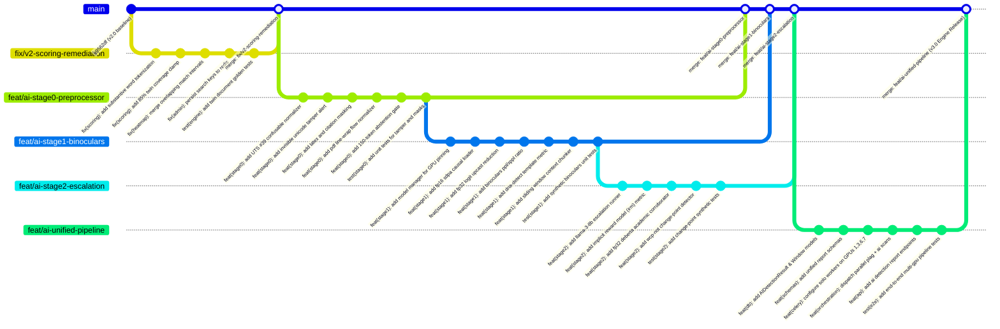

# Alethian v3.0: Backend Engine Implementation Plan
## Branchy Git Topology, Parallel Agent Dispatch & Granular Commit Protocol

**Author:** AI Systems Engineering  
**Target:** Alethian Backend Engine v3.0 (Plagiarism Remediation + Zero-Training AI Forensics)  
**Date:** 2026-11-22  
**Status:** Pre-Execution Architecture Plan  

---

## 1. Architectural Strategy & Git Tree Topology

To achieve the requested **branchy look in the git tree** while maintaining rigorous rollback safety, each engine component will be developed in an isolated feature branch, committed with fine-grained single-purpose commits, and merged back into `main` with explicit `--no-ff` (no-fast-forward) merge commits.



---

## 2. Granular Commit Discipline

To ensure complete reversibility and auditability:
- **No monolithic commits:** A commit must touch at most 1–3 closely related files representing a single testable unit.
- **Conventional Commits Standard:**
  - `fix(scope): ...` for bug fixes.
  - `feat(scope): ...` for new engine capabilities.
  - `refactor(scope): ...` for structural rewrites.
  - `test(scope): ...` for golden and unit test suites.
  - `chore(scope): ...` for configs, environment scripts, or migrations.
- **Immediate Rollback Guarantee:** Any commit can be cherry-picked or reverted using `git revert <hash>` without breaking surrounding modules.

---

## 3. Parallel Sub-Agent Work Breakdown (Hive-Inspired)

We partition the work across decoupled branches so sub-agents can build and test components in parallel without merge conflicts.

```
┌────────────────────────────────────────────────────────────────────────┐
│                        PARALLEL AGENT BOARD                            │
├─────────────────────────┬──────────────────────┬───────────────────────┤
│ AGENT 1 (Remediation)   │ AGENT 2 (Stage 0)    │ AGENT 3 (Stage 1)     │
│ Branch:                 │ Branch:              │ Branch:               │
│ fix/v2-scoring-...      │ feat/ai-stage0-...   │ feat/ai-stage1-...    │
│                         │                      │                       │
│ Scope:                  │ Scope:               │ Scope:                │
│ • report_engine.py      │ • preprocessor.py    │ • model_manager.py    │
│ • admin.py / config.py  │ • regex / UTS #39    │ • binoculars.py       │
│ • Twin score tests      │ • Tamper detection   │ • dna_detect.py       │
│ • Interval heatmap fix  │ • Abstention gate    │ • SDPA / FP32 upcast  │
└─────────────────────────┴──────────────────────┴───────────────────────┘
                                    │
                                    ▼
┌────────────────────────────────────────────────────────────────────────┐
│ AGENT 4 (Stage 2 Escalation & Localization)                            │
│ Branch: feat/ai-stage2-escalation                                      │
│ Scope:                                                                 │
│ • escalation.py (Llama-3-8B IRM + DeBERTa-v3 FP32)                     │
│ • localization.py (WCP + NOT Change-Point segmentation)                │
└────────────────────────────────────────────────────────────────────────┘
                                    │
                                    ▼
┌────────────────────────────────────────────────────────────────────────┐
│ AGENT 5 (Pipeline Integration & Cluster Deployment)                    │
│ Branch: feat/ai-unified-pipeline                                       │
│ Scope:                                                                 │
│ • DB models & Alembic migration (ai_detection_results)                 │
│ • celery_ai_worker.py (--pool=solo on GPUs 1, 3, 6, 7)                 │
│ • FastAPI endpoints & Redis status streaming                           │
│ • DGX live execution & Golden Benchmark Suite                         │
└────────────────────────────────────────────────────────────────────────┘
```

---

## 4. Phase-by-Phase Technical Specifications

### Phase 1: v2.0 Engine Remediation (`fix/v2-scoring-remediation`)
- **Objective:** Fix the 52% plagiarism score on twin files, eliminate all-red heatmap density over-counting, and persist search API keys.
- **Commits:**
  1. `fix(scoring): implement substantive word tokenization to ignore TOC dots`
  2. `fix(scoring): add 85% continuous body coverage clamp for verbatim twins`
  3. `fix(heatmap): merge overlapping character intervals per page before density calculation`
  4. `fix(admin): persist search keys to redis config:serper_api_key`
  5. `test(engine): add unit and regression tests for twin document scoring`
- **Verification Gate:** Run `15UCS032-19.pdf` against indexed archive. Score must be $\ge 99.8\%$ verbatim match ($0.0\%$ originality).

### Phase 2: Stage 0 Text Sanitization & Tamper Shield (`feat/ai-stage0-preprocessor`)
- **Objective:** Strip adversarial obfuscation, mask formulaic academic artifacts, and enforce the 150-token abstention floor.
- **Commits:**
  1. `feat(stage0): add UTS #39 confusable mapping and invisible unicode stripper`
  2. `feat(stage0): add orthogonal tamper alert trigger for >3 stripped anomalies`
  3. `feat(stage0): add regex masking for LaTeX equations, math environments, and citations`
  4. `feat(stage0): add PDF line-wrap and hyphenation normalizer`
  5. `feat(stage0): add substantive prose token counter and 150-token abstention gate`
  6. `test(stage0): add comprehensive test suite for unicode, math masking, and abstention`
- **Verification Gate:** 100% test pass on Cyrillic homoglyphs, zero-width spaces, complex LaTeX derivations, and short 50-token snippets.

### Phase 3: Stage 1 Primary Zero-Shot Scan (`feat/ai-stage1-binoculars`)
- **Objective:** Implement the dual-stream Falcon-7B Binoculars and DNA-DetectLLM scoring engine with Volta V100 GPU optimizations.
- **Commits:**
  1. `feat(stage1): add model manager for GPU-pinned singleton LLMs`
  2. `feat(stage1): configure PyTorch SDPA memory-efficient kernel on Volta sm_70`
  3. `feat(stage1): add FP32 logit upcasting to prevent softmax numerical overflow`
  4. `feat(stage1): implement Binoculars performer-PPL / cross-PPL ratio calculation`
  5. `feat(stage1): implement DNA-DetectLLM greedy template divergence metric`
  6. `feat(stage1): add 512-token sliding window context chunker with 256 stride`
  7. `test(stage1): add unit tests with mock logits and numerical stability assertions`
- **Verification Gate:** Verified zero-NaN execution in FP16 with FP32 logit reduction on GPUs 1 & 3.

### Phase 4: Stage 2 Escalation & Change-Point Localization (`feat/ai-stage2-escalation`)
- **Objective:** Implement the deep-audit escalation suite (Llama-3-8B IRM + DeBERTa-v3) and WCP+NOT change-point paragraph boundary detector.
- **Commits:**
  1. `feat(stage2): add Llama-3-8B pair escalation runner for borderline scores`
  2. `feat(stage2): implement Implicit Reward Model (IRM) closed-form DPO ratio`
  3. `feat(stage2): add Desklib DeBERTa-v3 academic classifier in native FP32`
  4. `feat(stage2): implement Weighted CUSUM + Narrowest-Over-Thresholding (WCP+NOT)`
  5. `feat(stage2): add paragraph risk gradient aggregator and transition interval mapper`
  6. `test(stage2): add synthetic change-point tests and multi-metric aggregation tests`
- **Verification Gate:** Synthetic hybrid document correctly localizes human-to-AI transition boundary within 10 tokens.

### Phase 5: Unified Pipeline Orchestration & Cluster Deployment (`feat/ai-unified-pipeline`)
- **Objective:** Wire together the database models, dual Celery queues, FastAPI status endpoints, and execute DGX cluster integration.
- **Commits:**
  1. `feat(db): add AIDetectionResult and AIDetectionWindow SQLAlchemy models`
  2. `feat(schemas): add unified report and AI detection Pydantic v2 schemas`
  3. `feat(celery): create celery_ai_worker.py with --pool=solo topology on GPUs 1,3,6,7`
  4. `feat(orchestration): dispatch parallel Celery workflows for plagiarism and AI scans`
  5. `feat(api): add GET /reports/{id}/ai-detection and stream lifecycle updates via Redis`
  6. `test(e2e): add end-to-end integration tests for full document processing`
- **Verification Gate:** Live submission on DGX runs plagiarism on GPU 4 and AI detection on GPUs 1 & 3 simultaneously, generating a complete dual-track report in PostgreSQL.

---

## 5. Golden Benchmark Evaluation Suite (Verification Gate)

Before finalizing Option A, the engine must pass 5 automated end-to-end golden verification tests:

| Test Case | Input Document | Expected Plagiarism | Expected AI Tier | Key Assertion |
| :--- | :--- | :--- | :--- | :--- |
| **TC-1: Archive Twin** | `15UCS032-19.pdf` | $\ge 99.8\%$ | T0 (Human) | Score bug resolved; no false AI alert |
| **TC-2: Clean Holdout** | Unindexed thesis | $\le 15.0\%$ | T0 (Human) | Genuine research cleared |
| **TC-3: ESL Manuscript** | Non-native paper | $\le 15.0\%$ | T0 (Human) | **Zero ESL bias** ($B(s) \ge 0.9015$) |
| **TC-4: Pure AI Paper** | GPT-4o thesis | $\le 10.0\%$ | **T3 (Elevated AI)** | Multi-metric consensus ($B(s) < 0.8350$) |
| **TC-5: Hybrid Paper** | AI intro + Human body| Variable | **T2 (Mixed AI)** | WCP+NOT accurately segments Section 1 |
| **TC-6: Unicode Obfuscated**| Cyrillic homoglyphs | Corrected | Tamper Alert | Orthogonal `tamper_alert=True` flag |
| **TC-7: Short Excerpt** | 80-token abstract | N/A | **Abstain** | `abstained=True` (<150 prose tokens) |

---

## 6. Execution Protocol

We will proceed systematically:
1. Initialize the git branches off `main`.
2. Dispatch the sub-agents across the decoupled modules.
3. Commit every unit of work granularly with proper commit messages.
4. Merge each branch into `main` with `--no-ff` to preserve the branch DAG.
5. Deploy and verify on the DGX cluster.
