# Alethian v3.0: Comprehensive Engineering Implementation Plan & Frontend Unslopping Blueprint

**Author:** AI Systems Engineering Board  
**Target:** Alethian v3.0 (Unified Plagiarism & Zero-Shot AI Forensic Platform)  
**Date:** 2026-11-22  
**Status:** Approved for Implementation  

---

## Executive Overview & System Vision

Alethian v3.0 evolves the platform from a standalone semantic plagiarism search engine into a **Unified Academic Integrity Platform**. It pairs high-recall plagiarism cross-referencing (internal vector archives + live web dragnet) with a **cascaded, zero-training statistical AI text generation detector** (Binoculars + DNA-DetectLLM + Stage-2 Escalation).

Crucially, this release addresses the **severe visual fatigue and clutter** of the current interface. Applying the **Unslop** methodology, the cluttered 3-column dashboard is replaced with a **calm, forensic 2-pane reading canvas**: a 75%–100% distraction-free academic document workspace supported by a quiet, consolidated right-hand forensic inspector.

---

```
┌────────────────────────────────────────────────────────────────────────────────────────┐
│                               ALETHIAN v3.0 SYSTEM ARCHITECTURE                        │
├────────────────────────────────────────────────────────────────────────────────────────┤
│ INGESTION & STAGE 0 (CPU Pool - 80 Cores)                                              │
│   • 3-Tier PDF Extractor: Grobid ──> pypdf ──> Tesseract OCR                           │
│   • Unicode Tamper Shield: UTS #39 Confusables + Zero-Width Stripper (Tamper Alert)    │
│   • Academic Masker: LaTeX equations, inline math, citations & reference blocks        │
│   • Flow Normalizer: Rejoin hyphenated line wraps & PDF column breaks                  │
│   • Abstention Filter: Hard suppression if prose < 150 tokens                          │
├────────────────────────────────────────┬───────────────────────────────────────────────┤
│ TRACK A: PLAGIARISM & SIMILARITY       │ TRACK B: ZERO-TRAINING AI FORENSICS           │
│ (Celery Queue: plagiarism_scan)        │ (Celery Queue: ai_detection / ai_escalation)  │
│                                        │                                               │
│ • GPU 4: all-MiniLM-L6-v2 Embeddings   │ • STAGE 1 (GPUs 1 & 3, Solo Worker):          │
│ • Qdrant: Exact (≥0.95) & Paraphrase   │   - Falcon-7B (Observer) + Instruct (Performer│
│ • Web Dragnet: Serper / SerpApi + DDGS │   - Metrics: Binoculars + DNA-DetectLLM       │
│ • Dynamic Content Scraper & Diff Match │   - Low-FPR ESL Invariance (0.0%–0.1% FPR)    │
│                                        │                                               │
│                                        │ • STAGE 2 ESCALATION (GPUs 6 & 7, Solo):      │
│                                        │   - Triggered only if Stage 1 Score < 0.8536  │
│                                        │   - Llama-3-8B Pair (Binoculars + DNA + IRM)  │
│                                        │   - DeBERTa-v3 Academic Classifier (FP32)     │
│                                        │   - WCP+NOT Change-Point Localization         │
├────────────────────────────────────────┴───────────────────────────────────────────────┤
│ UNIFIED REPORT ENGINE & FORENSIC CANVAS (React + Tailwind v3.0 "Unslopped")            │
│   • Left Canvas (75%–100%): Pristine A4 Document View + Subtle Soft-Tint Annotations   │
│   • Margin: Vertical Page Radar strip (Clean / Plagiarism / AI Anomaly)               │
│   • Right Inspector (25%): Tabbed Evidence Drawer (Plagiarism, AI Metrics, Sources)    │
│   • Inline Diff Flyout: Side-by-side evidence card on click (replaces bottom drawer)   │
│   • 4-Tier Evidentiary Verdict: Due-process triage bands, NEVER binary "AI %" flags    │
└────────────────────────────────────────────────────────────────────────────────────────┘
```

---

## Part 1: Detailed Phased Implementation Roadmap

### Phase 0: Baseline Stabilization & Remediation (Immediate)

> [!IMPORTANT]
> The four structural bugs diagnosed in v2.0 must be permanently resolved before mounting AI detection models, ensuring baseline scoring and report exports are pristine.

#### 0.1 Substantive Word Tokenization Fix
- **File:** `Alethian/backend/app/core/report_engine.py`
- **Root Cause:** Dotted leaders (`. . . . .`) in Table of Contents generate up to 50% of tokens in `text.split()`, artificially driving identical twin documents down to 51.99%.
- **Surgical Patch:**
  ```python
  def _count_substantive_words(text: str) -> int:
      """Count tokens containing at least one alphanumeric character."""
      return sum(1 for w in text.split() if any(c.isalnum() for c in w))

  def calculate_originality(matches: List[Dict[str, Any]], doc_word_count: int, doc_text: Optional[str] = None) -> float:
      if doc_word_count == 0:
          return 100.0
      
      ranges = []
      for m in matches:
          if not m.get('is_excluded'):
              start = m.get('submitted_start_char', 0)
              end = m.get('submitted_end_char', start + len(m.get('submitted_text', '')))
              if start < end:
                  ranges.append((start, end))

      if not ranges:
          return 100.0

      # Merge overlapping match intervals
      ranges.sort()
      merged = [ranges[0]]
      for start, end in ranges[1:]:
          if start <= merged[-1][1]:
              merged[-1] = (merged[-1][0], max(merged[-1][1], end))
          else:
              merged.append((start, end))

      if doc_text:
          substantive_total = max(1, _count_substantive_words(doc_text))
          matched_words = sum(_count_substantive_words(doc_text[s:e]) for s, e in merged)
          coverage = matched_words / substantive_total
      else:
          total_matched_chars = sum(end - start for start, end in merged)
          matched_words = total_matched_chars / 6.0
          coverage = matched_words / max(1, doc_word_count)

      # 85% substantive threshold clamp for identical twins
      if coverage > 0.85:
          return 0.0
      return max(0.0, min(100.0, (1.0 - coverage) * 100.0))
  ```

#### 0.2 Per-Page Heatmap Interval Merging
- **File:** `Alethian/backend/app/core/report_engine.py`
- **Root Cause:** Sliding-window overlaps sum word counts 3–5× over page capacity, pegging every page density at `1.0` (all-red).
- **Surgical Patch:** In `generate_heatmap()`, group matches by `submitted_page`, sort intervals, merge overlapping character spans `[(m.start, m.end)]`, and calculate matched length from the *union* of intervals divided by actual page word count.

#### 0.3 Browser Print Engine Multi-Page Pagination
- **File:** `Alethian/frontend/src/index.css`
- **Root Cause:** `#alethian-report-container` and parent divs have `h-screen` and `overflow-hidden`, clipping printed output to viewport page 1.
- **Surgical Patch:** Inject print stylesheet freeing overflow and forcing page breaks:
  ```css
  @media print {
    html, body, #root, #alethian-report-container, main,
    .overflow-hidden, .overflow-y-auto, .h-screen {
      height: auto !important;
      overflow: visible !important;
      position: static !important;
    }
    aside, header, nav, .no-print, [class*="diff-viewer"] {
      display: none !important;
    }
    .report-page-card {
      page-break-before: always !important;
      break-before: page !important;
      margin: 0 !important;
      box-shadow: none !important;
    }
  }
  ```

#### 0.4 Search Key Persistence & Dual-Gateway Support
- **Files:** `Alethian/backend/app/api/admin.py`, `Alethian/backend/app/core/web_dragnet.py`
- **Surgical Patch:** Persist `serper_api_key` to Redis key `config:serper_api_key`. Add auto-detection for SerpApi (`https://serpapi.com/search.json?api_key=...`) vs. Serper (`https://google.serper.dev/search`).

---

### Phase 1: DGX GPU Environment & HuggingFace Cache Scaffolding

#### 1.1 GPU Process Isolation Topology
The DGX-1 server (`ak-dgx`, 8 × V100-SXM2 32GB) must be partitioned to prevent GPU memory collisions and CUDA fork exceptions:

| GPU Device | Dedicated Role | Process Type | Concurrency & Pool |
| :--- | :--- | :--- | :--- |
| **GPU 4** | Plagiarism Worker (sentence-transformers MiniLM-L6) | Celery Worker | `--pool=solo`, queue: `plagiarism_scan` |
| **GPU 1** | Stage 1 AI Observer (`tiiuae/falcon-7b`) | Celery AI Worker | `--pool=solo`, queue: `ai_detection` |
| **GPU 3** | Stage 1 AI Performer (`tiiuae/falcon-7b-instruct`) | (Paired with GPU 1) | Shared CUDA dual-stream |
| **GPU 6** | Stage 2 AI Observer (`meta-llama/Meta-Llama-3-8B`) | Celery Escalation Worker | `--pool=solo`, queue: `ai_escalation` |
| **GPU 7** | Stage 2 AI Performer (`Meta-Llama-3-8B-Instruct`) + DeBERTa-v3 | (Paired with GPU 6) | Shared CUDA dual-stream + FP32 DeBERTa |
| **GPUs 0, 2, 5** | Reserved / User Workloads | External | Unmodified |

#### 1.2 Model Pre-Caching Script
Run inside `/home/23ucs529/alethian_backend_env` on `ak-dgx`:
```python
# scripts/cache_models.py
import torch
from transformers import AutoTokenizer, AutoModelForCausalLM, AutoModelForSequenceClassification

MODELS = [
    ("tiiuae/falcon-7b", "causal"),
    ("tiiuae/falcon-7b-instruct", "causal"),
    ("meta-llama/Meta-Llama-3-8B", "causal"),
    ("meta-llama/Meta-Llama-3-8B-Instruct", "causal"),
    ("desklib/ai-text-detector-academic-v1.01", "classification"),
]

for model_id, mtype in MODELS:
    print(f"Caching {model_id}...")
    AutoTokenizer.from_pretrained(model_id)
    if mtype == "causal":
        AutoModelForCausalLM.from_pretrained(model_id, torch_dtype=torch.float16)
    else:
        AutoModelForSequenceClassification.from_pretrained(model_id, torch_dtype=torch.float32)
    print(f"✓ {model_id} ready.")
```

---

### Phase 2: Stage 0 Academic Preprocessing & Tamper Detection

Create `Alethian/backend/app/core/ai_detection/preprocessor.py`:

```
Input Text
    │
    ▼
[Step 1] UTS #39 Confusables & Invisible Unicode Stripper
    │    ├── Strips U+200B..U+200F, U+FEFF
    │    └── Emits orthogonal "Tamper Alert" if > 3 anomalies found
    ▼
[Step 2] Academic Structure Masker
    │    ├── Replaces LaTeX environments (\begin{equation}) with [MATH]
    │    ├── Replaces inline $...$ and $$...$$ with [MATH]
    │    └── Replaces citations ((Smith et al., 2024), [12]) with [CIT]
    ▼
[Step 3] PDF Line-Wrap & Formatting Normalizer
    │    ├── Re-joins hyphenated line wraps (compu-\nter → computer)
    │    └── Normalizes hard wraps to flowing prose (removes R²=0.61 surface bias)
    ▼
[Step 4] Token Floor & Abstention Gate
         └── If substantive tokens < 150: return status ABSTAIN (prevents 29% short-text FPR)
```

---

### Phase 3: Stage 1 Zero-Training Primary Scan (Binoculars + DNA-DetectLLM)

Create `Alethian/backend/app/core/ai_detection/binoculars.py`:

#### 3.1 Mathematical Implementation
Computes Performer Log-PPL and Observer-Performer Cross-PPL in a single concurrent forward pass:

$$\log \text{PPL}_{M_2}(s) = -\frac{1}{|I|}\sum_{i \in I} \log P_{M_2}(x_i \mid x_{<i})$$

$$\log \text{X-PPL}_{M_1, M_2}(s) = -\frac{1}{|I|}\sum_{i \in I} \sum_{v \in \mathcal{V}} P_{M_1}(v \mid x_{<i}) \log P_{M_2}(v \mid x_{<i})$$

$$\text{Binoculars}(s) = \frac{\log \text{PPL}_{M_2}(s)}{\log \text{X-PPL}_{M_1, M_2}(s)}$$

$$\text{DNA-DetectLLM}(s) = \frac{1}{2}\left[\text{Binoculars}(s) + \frac{-\frac{1}{|I|}\sum_{i \in I}\log P_{M_2}(\hat{x}_i \mid x_{<i})}{\log \text{X-PPL}_{M_1, M_2}(s)}\right]$$

#### 3.2 GPU Kernel Hardening for Volta V100
1. **Model Loader:** Force `torch_dtype=torch.float16` and `config.use_cache=False`.
2. **Attention Backend:** Force `attn_implementation="sdpa"`. Dispatches to PyTorch 2.6's xFormers-based `mem_efficient` kernel, fully supported on Volta sm_70.
3. **Logits Upcast:** Cast `logits.float()` to FP32 immediately on GPU before invoking `F.log_softmax` and `F.softmax`, eliminating FP16 saturation at 65,504.

#### 3.3 Sliding Window & Token Aggregation
- 512-token context windows with 256-token stride (50% overlap).
- Warmup discard: drop the first 128 tokens of non-initial windows so every scored token has 256–512 tokens of prior context.

---

### Phase 4: Stage 2 Escalation Audit & Change-Point Localization

Create `Alethian/backend/app/core/ai_detection/escalation.py` and `localization.py`:

#### 4.1 Stage 2 Trigger Rule
A document or section escalates to Stage 2 **only if** Stage 1 score is in the indeterminate or elevated risk band ($B(s) < 0.8536$). 80% of human submissions clear Stage 1 without using Stage 2 compute.

#### 4.2 Multi-Metric Consensus Suite
1. **Llama-3-8B Binoculars + DNA-DetectLLM:** Independent confirmation on frontier-grade open weights.
2. **Implicit Reward Model (IRM):** DPO closed-form log-policy ratio between aligned instruct and base models:
   $$r_{\text{IRM}}(s) = \frac{1}{|I|}\sum_{i \in I}\log\frac{P_{\pi_\theta}(x_i \mid x_{<i})}{P_{\pi_{\text{ref}}}(x_i \mid x_{<i})}$$
   Measures preference-alignment signal; yields 99.15% AUROC on paraphrased outputs.
3. **DeBERTa-v3 Academic Corroborator:** `desklib/ai-text-detector-academic-v1.01` executed strictly in **FP32** to avoid known architectural FP16 instability.

#### 4.3 WCP+NOT Change-Point Localization
Applies Weighted CUSUM + Narrowest-Over-Thresholding (NOT) recursion over per-window token residuals to isolate mixed human–AI transition boundaries, returning exact character intervals `[(start, end, is_ai_segment)]`.

---

### Phase 5: Unified Database Schema & API Integration

#### 5.1 Database Schema Additions (`models.py`)
```python
class AIDetectionResult(Base):
    __tablename__ = "ai_detection_results"

    id = Column(String, primary_key=True, default=lambda: str(uuid.uuid4()))
    report_id = Column(String, ForeignKey("reports.id"), unique=True)
    
    binoculars_score = Column(Float, nullable=True)
    dna_detect_score = Column(Float, nullable=True)
    stage1_model_pair = Column(String, default="falcon-7b/falcon-7b-instruct")
    
    escalated = Column(Boolean, default=False)
    llama_binoculars_score = Column(Float, nullable=True)
    irm_score = Column(Float, nullable=True)
    deberta_probability = Column(Float, nullable=True)
    stage2_model_pair = Column(String, nullable=True)
    
    verdict_tier = Column(String, nullable=False) # 'T0_HUMAN', 'T1_INDETERMINATE', 'T2_ELEVATED', 'T3_HIGH'
    confidence = Column(Float, nullable=True)
    abstained = Column(Boolean, default=False)
    tamper_alert = Column(Boolean, default=False)
    tamper_count = Column(Integer, default=0)
    
    windows = Column(JSONB, nullable=True) # [{page, start_char, end_char, score, is_ai}]
    stage1_latency_ms = Column(Integer, nullable=True)
    stage2_latency_ms = Column(Integer, nullable=True)
    created_at = Column(DateTime, default=lambda: datetime.datetime.now(datetime.timezone.utc))

    report = relationship("Report", backref="ai_detection")
```

#### 5.2 Unified Evidentiary Triage Matrix
Never output a raw percentage probability (e.g. "92% AI"). Instead, output standard evidentiary tiers:

| Tier | Falcon-7B Binoculars Band | Meaning & Due-Process Protocol | Faculty Presentation |
| :--- | :--- | :--- | :--- |
| **Abstain** | Any score (<150 tokens) | Insufficient sample length for reliable statistics | "Abstained: Insufficient prose length" |
| **Tier 0** | $B(s) \ge 0.9015$ | Statistically consistent with human authorship | Neutral — Cleared |
| **Tier 1** | $0.8536 \le B(s) < 0.9015$ | Indeterminate human/AI overlap zone | Inconclusive — No action |
| **Tier 2** | $0.8350 \le B(s) < 0.8536$ | Elevated AI signal; corroborated by Stage 2 | Mixed Evidence — Review highlighted paragraphs |
| **Tier 3** | $B(s) < 0.8350$ | High-confidence AI signal across multi-model consensus | Strong Statistical Signal — Request draft history / oral review |

---

## Part 2: The Frontend Unslopping Blueprint

The current Alethian frontend suffers from typical "AI prototype slop":
- A cramped 3-column grid where the document is restricted to ~50% width.
- A heavy bottom drawer that blocks 35% of the text during comparison.
- Over-saturated neon red fills (`#dc2626`) across whole paragraphs.
- Rainbow metrics, glowing borders, uppercase tracked labels, and emoji-decorated cards.
- Viewport trapping (`h-screen overflow-hidden`) that breaks browser printing.

Following the **Unslop** methodology, we execute a comprehensive 9-pass design overhaul.

---

### Unslop Direction Statement

```
Product:   A forensic academic integrity workstation for university faculty and integrity boards
           to audit student submissions for plagiarism and AI text generation.
Character: Calm, forensic, exact.
World:     The university examination board, research archives, and legal briefs.
           Graphite, ivory paper, muted ink, precise marginalia.
Moments:   The pristine, centered document canvas with soft-tint annotations,
           and the side-by-side evidence inspection flyout.
Signature: A vertical Page Radar strip in the document margin showing forensic density
           at a glance without layout clutter.
```

---

### The 9-Pass Unslopping Execution

#### Pass 1: Spacing & Rhythm (Strict 4px Scale)
- **Eliminate random margins:** Replace all one-off paddings (`p-[13px]`, `mt-5`, `py-3`) with strict 4px grid steps: `p-4` (16px), `p-6` (24px), `gap-3` (12px), `gap-4` (16px).
- **Proportional Shell:**
  - Reading canvas: Expands to **75% of viewport width** (capped at 1100px max reading width for optimal typographic line-lengths).
  - Focus Mode (`Key: F`): Expands canvas to **100% width**, collapsing all sidebars.
  - Forensic Inspector: Fixed at **360px** on the right edge.
- **Consistent List Spacing:** Match cards share identical height and vertical gap (`gap-2.5`, 10px).

#### Pass 2: Color Palette (Graphite Neutral Ramp & Toned Tints)
- **Neutral Ramp:** Migrate all chrome surfaces to a tinted graphite ramp:
  - Canvas Backdrop: Light `#f8fafc` (Slate 50) / Dark `#0f172a` (Slate 950).
  - Document Sheet: Pure White `#ffffff` / Dark `#1e293b` (Slate 900) with a 1px hairline border (`border-slate-200 / border-slate-800`).
- **Demote Neon Highlights:** Drop heavy `#dc2626` background fills. Replace with academic soft tints:
  - Exact Plagiarism: `rgba(239, 68, 68, 0.12)` with a 2px solid bottom accent line (`#ef4444`).
  - Paraphrased Plagiarism: `rgba(245, 158, 11, 0.12)` with an amber accent line (`#f59e0b`).
  - Web Match: `rgba(59, 130, 246, 0.12)` with a blue accent line (`#3b82f6`).
  - AI-Generated Text: `rgba(168, 85, 247, 0.12)` with a purple accent line (`#a855f7`).
- **Quiet Text Hierarchy:** Exactly 3 text roles: Primary (`text-slate-900 / dark:text-slate-100`), Secondary (`text-slate-600 / dark:text-slate-400`), Muted (`text-slate-400 / dark:text-slate-500`).

#### Pass 3: Icons (Consistent Lucide Set)
- Strip all emojis (`✨`, `🚀`, `👋`, `⚠️`).
- Use Lucide line icons exclusively at **16px size with 1.5px stroke**.
- Icons inherit the text color of their parent role; no standalone multicolored icon boxes.

#### Pass 4: Copy & Tone (Clinical Forensic Language)
- Eliminate shouting headlines and exclamation marks.
- No greeting banners ("Welcome back, Investigator!"). Page title is simply the document title and submission timestamp.
- Replace generic "Plagiarism Score" with specific metrics: "Archive Match Coverage", "Web Overlap", "AI Triage Tier".
- End labels, buttons, and captions without trailing periods.

#### Pass 5: Typography (Academic Legibility)
- **Primary Typeface:** Clean, high-legibility sans-serif (`Inter` or `Public Sans`) for UI chrome.
- **Document Body Typeface:** Scholarly serif (`Source Serif 4` or `Charter`) for the submitted paper text to optimize multi-page reading comfort.
- **Figures & Metadata:** Strict `font-mono tabular-nums` for all scores, character offsets, and timestamps.
- **Eliminate Heavy Tracking:** Remove uppercase tracking (`tracking-widest uppercase text-xs`). Use natural sentence case.

#### Pass 6: Layout Modernization (Focus Canvas + Inspector)

```
CURRENT V2.0 CLUTTERED GRID (50% Canvas)
┌──────────────┬──────────────────────────────┬──────────────┐
│ Left Panel   │ Center Canvas                │ Right Panel  │
│ - Heatmap    │ - Squeezed Document View     │ - Score Card │
│ - Filter Bar │ - Stacking Highlights        │ - Pie Chart  │
│ - Anomaly    │ - Bottom Diff Drawer         │ - Bar Chart  │
│   Cards      │   (Blocks 35% of text!)      │ - Web List   │
└──────────────┴──────────────────────────────┴──────────────┘

                              ▼

UNSLOPPED V3.0 FORENSIC WORKSTATION (75%–100% Canvas)
┌────────────────────────────────────────────────────────┬──────────────┐
│ PRIMARY FORENSIC CANVAS (75% - 100% width)             │ FORENSIC     │
│ [Focus Mode: 'F']                                      │ INSPECTOR    │
│                                                        │ (360px wide) │
│ ┌───┐ ┌──────────────────────────────────────────────┐ │ [TABBED]     │
│ │ R │ │ A4 Document Sheet (Source Serif 4)           │ │ • Matches    │
│ │ a │ │                                              │ │ • AI Audit   │
│ │ d │ │  Chapter 1: Introduction                     │ │ • Sources    │
│ │ a │ │  The implementation of distributed...        │ │ • Protocol   │
│ │ r │ │  ══════════════════════════════ [Source #1 ▾]│ │              │
│ └───┘ │  (Clicking highlight reveals inline flyout)  │ │ [Match Card] │
│       │                                              │ │ 94% Verbatim │
│       │  [Floating Side-by-Side Comparison Flyout]   │ │ Thesis 2021  │
│       └──────────────────────────────────────────────┘ │              │
└────────────────────────────────────────────────────────┴──────────────┘
```

#### Pass 7: Details & Controls
- **Kill the Bottom Drawer:** When an investigator clicks any highlighted passage, open a sleek **Side-by-Side Floating Diff Flyout** that docks to the right or anchors in the margin like a Google Docs comment. The examined text is never covered.
- **Vertical Page Radar:** Replace the clunky box heatmap with a 24px-wide vertical strip on the left margin. Page ticks are color-coded (green = clean, amber = paraphrase, red = verbatim, purple = AI) and clickable to jump immediately to that page.
- **Nested Radii:** Cards `rounded-lg` (8px), buttons `rounded-md` (6px), tags `rounded` (4px). No oversized pill buttons.

#### Pass 8: Visual Craft (The Document as the Hero)
- The centerpiece of the interface is the student's paper, rendered with realistic A4 page margins, page numbers, and crisp academic typography.
- Secondary charts (pie/bar) are demoted to a quiet "Telemetry" sub-tab in the inspector, never competing with the reading canvas.

#### Pass 9: Motion & Interaction
- Fast, purposeful micro-transitions (`duration-150 ease-out`).
- Tab switches fade with a subtle 4px vertical rise.
- Zero bouncing, zero pulsing badges, zero looping loading shimmers.

---

## Part 3: Step-by-Step Execution Sequence

```mermaid
flowchart TD
    subgraph S1["Phase 0: Engine Stabilization (Day 1)"]
        P0_1["Fix 0.1: Substantive Word Counting"]
        P0_2["Fix 0.2: Heatmap Interval Merging"]
        P0_3["Fix 0.3: Multi-Page Print CSS"]
        P0_4["Fix 0.4: Search Key Persistence"]
    end

    subgraph S2["Phase 1: GPU Cluster & Model Setup (Day 2)"]
        P1_1["Partition GPUs (1,3,4,6,7)"]
        P1_2["Cache Falcon-7B & Llama-3-8B on NVMe"]
        P1_3["Verify FP16 & SDPA on Volta sm_70"]
    end

    subgraph S3["Phase 2 & 3: AI Engine Pipeline (Days 3-6)"]
        P2_1["Stage 0: Unicode Tamper & LaTeX Masking"]
        P3_1["Stage 1: Falcon-7B Binoculars + DNA-DetectLLM"]
        P4_1["Stage 2: Llama-3-8B IRM + DeBERTa Corroborator"]
        P4_2["WCP+NOT Change-Point Localization"]
    end

    subgraph S4["Phase 4: Unified Backend (Days 7-8)"]
        P5_1["PostgreSQL Migration (ai_detection_results)"]
        P5_2["Celery Worker Pinning (--pool=solo)"]
        P5_3["Unified API Schema & Status Streaming"]
    end

    subgraph S5["Phase 5: Frontend Unslopping (Days 9-12)"]
        P6_1["Pass 1-5: Tokens, Graphite Palette & Typography"]
        P6_2["Pass 6: 2-Pane Focus Canvas + Margin Radar"]
        P6_3["Pass 7: Floating Inline Diff Flyout"]
        P6_4["Pass 8-9: Dual-Layer Heatmap & Print Hardening"]
    end

    subgraph S6["Phase 6: E2E Verification (Day 13)"]
        P7_1["Run Golden Benchmarks (ESL, Twins, Mixed)"]
        P7_2["Faculty Due-Process Sign-Off Verification"]
    end

    S1 --> S2 --> S3 --> S4 --> S5 --> S6
```



---

## Part 4: File Modification Matrix

| File Path | Type | Action Required |
| :--- | :--- | :--- |
| `Alethian/backend/app/core/report_engine.py` | Python | Apply substantive word counting, interval-merged heatmap, and unified AI scoring |
| `Alethian/backend/app/core/config.py` | Python | Add AI detection model constants, thresholds, and worker GPU IDs |
| `Alethian/backend/app/db/models.py` | Python | Add `AIDetectionResult` and `AIDetectionWindow` SQLAlchemy models |
| `Alethian/backend/app/core/ai_detection/preprocessor.py` | Python | **New File:** Stage 0 Unicode tamper gate, LaTeX masker, and abstention check |
| `Alethian/backend/app/core/ai_detection/binoculars.py` | Python | **New File:** Stage 1 Binoculars + DNA-DetectLLM dual-stream GPU inference |
| `Alethian/backend/app/core/ai_detection/escalation.py` | Python | **New File:** Stage 2 Llama-3-8B IRM + DeBERTa academic audit |
| `Alethian/backend/app/core/ai_detection/localization.py` | Python | **New File:** WCP+NOT change-point paragraph boundary detector |
| `Alethian/backend/celery_ai_worker.py` | Python | **New File:** Dedicated `--pool=solo` Celery service pinned to GPUs 1 & 3 |
| `Alethian/frontend/src/index.css` | CSS | Add print stylesheet, graphite design tokens, and soft-tint highlight classes |
| `Alethian/frontend/src/pages/ReportView.jsx` | React | Refactor to 2-pane Focus Canvas (75%–100%) with collapsible right inspector |
| `Alethian/frontend/src/components/report/TextOverlay.jsx` | React | Fix slicing cursor bug, render soft-tint underlines, attach inline flyout trigger |
| `Alethian/frontend/src/components/report/DiffViewer.jsx` | React | Convert from heavy bottom drawer into floating side-by-side comparison flyout |
| `Alethian/frontend/src/components/report/PageRadar.jsx` | React | **New File:** Sleek vertical marginal navigation strip replacing box heatmap |
| `Alethian/frontend/src/components/report/ForensicInspector.jsx` | React | **New File:** Consolidated tabbed right drawer (Matches, AI Audit, Sources, Sign-off) |

---

## Deliverables Summary

This refined blueprint provides:
1. **The Complete v3.0 AI Detection Engine:** Zero-training, mathematically grounded in Binoculars and DNA-DetectLLM, hardware-hardened for NVIDIA V100 Volta GPUs.
2. **The Complete Frontend Unslopping Plan:** Transforms the cluttered 3-column prototype into a focused, distraction-free academic forensic reading environment.
3. **Strict Due-Process Integrity:** Eliminates misleading percentage AI probabilities in favor of legally defensible evidentiary triage tiers.
