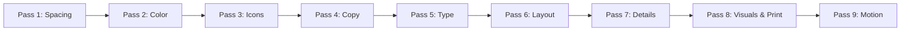
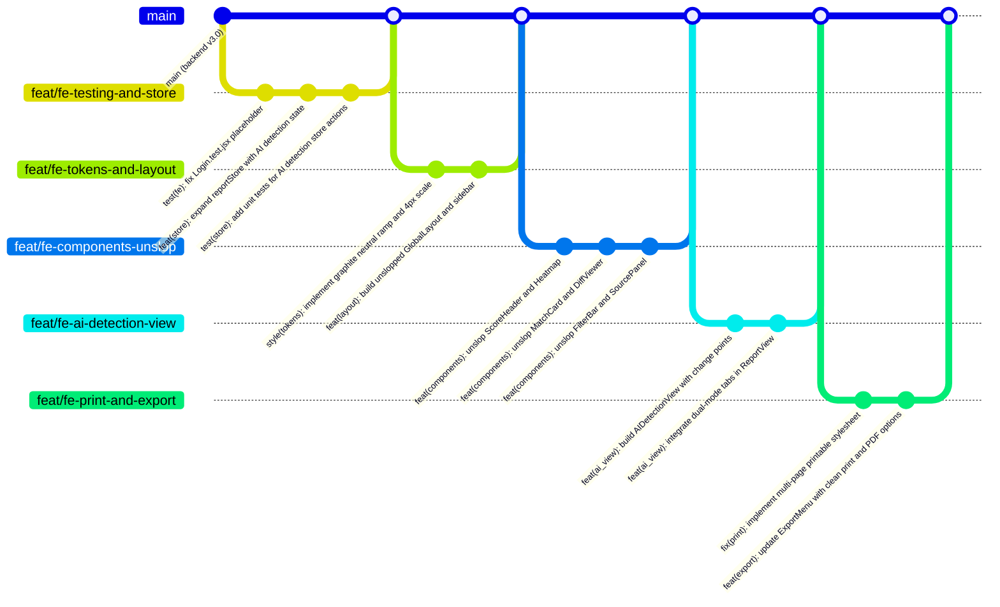

# Alethian v3.0: Frontend 9-Pass Unslopping & Implementation Plan

**Target Application:** Alethian Academic Integrity & AI Detection System  
**Design Standard:** Unslop Craft Standard (CC-BY-4.0 by Damir Sokolovsky)  
**Engineering Methodology:** Eval-Driven Development (EDD) + Granular Branchy Git Workflow

---

## 1. Unslop Direction (The 5 Core Axioms)

Before editing any code, we establish the 5 directional lines that govern every design choice:

1. **Product:** A forensic-grade academic integrity workbench for university faculty and researchers to audit document originality, verify citations, and detect synthetic AI text generation with verifiable mathematical rigor.
2. **Character:** `Calm, exact, clinical, scholarly.` (No hype words like *seamless*, *magic*, or *supercharged*; no loud gradients or glowing neon elements).
3. **World:** Lives in the world of academic archives, library reading rooms, and forensic analytical instruments — characterized by quiet graphite desks, crisp paper white, and muted archival inks.
4. **Moments:**
   - *Moment 1:* The **Forensic Dual-Diff Viewer** — side-by-side passage comparison showing matched source text vs. submitted thesis text with word-level strike/add diffs.
   - *Moment 2:* The **Change-Point Timeline & Risk Gradient Map** — localized paragraph-level transition visualization showing exactly where human writing shifts to AI-generated text.
5. **Signature:** A crisp **Evidentiary Integrity Seal** — a subtle monospace verification stamp (`ALETHIAN-SHA256-DIGITAL-SIGNATURE`) displaying verification timestamp, forensic tier, and reviewer endorsement.

---

## 2. The 9-Pass Unslopping Protocol

### Pass 1: Spacing & Rhythm
- Strict **4px Grid** on all elements:
  - Margins, paddings, gaps, and component heights adhere to multiples of 4px (`4, 8, 12, 16, 20, 24, 32, 48, 64px`).
  - Sidebar: fixed width of `260px` with compact row heights of `36px` and `4px` gaps.
  - Cards: uniform padding of `20px` (dense lists `16px`, page margins `32px`).
  - Equal items have equal dimensions: all match cards in a list share identical padding and alignment.

### Pass 2: Color & Neutral Ramp
- **Graphite Neutral Ramp:**
  - Base background: `#0d0e11` (dark) / `#f8fafc` (light)
  - Surface layer 1: `#131519` (cards, sidebars)
  - Surface layer 2: `#1a1d23` (elevated panels, modals, dropdowns)
  - Hairline borders: `#262931` (semi-transparent border, 1px solid)
- **Three Text Roles:**
  - Primary text: `#f1f3f7` (high contrast, high legibility)
  - Secondary text: `#9ba1b0` (metadata, labels, descriptions)
  - Muted text: `#626773` (captions, timestamps, disabled controls)
- **Single Accent:**
  - Accent: `#2563eb` (scholarly cobalt blue) used sparingly for primary actions and active tabs.
  - Semantic risk indicators:
    - Low Risk / Clean: `#10b981` (subdued emerald)
    - Moderate / Inconclusive: `#f59e0b` (subdued amber)
    - High Risk / Elevated AI: `#ef4444` (subdued crimson, not screaming neon pink)
- **Eliminate:** All background hue gradients, glowing colored card shadows, neon borders, and radial color washes.

### Pass 3: Icons & Visual Marks
- **Zero Emojis:** Remove all decorative emojis (`✨`, `👋`, `🚀`, `🔥`, `📊`, `⚠️`) from buttons, tabs, headers, and status cards.
- **Unified Lucide Set:** Every icon is Lucide React rendered at `16px` or `18px` with a consistent `1.5` stroke width.
- **Quiet Icons:** Icons inherit the color of their text role (`secondary` or `muted`). They do not have custom background circles or rainbow colors.

### Pass 4: Copy & Academic Tone
- **Sentence Case:** Replace uppercase shouting labels (`ORIGINALITY SCORE`, `HEATMAP OVERVIEW`, `ALL MATCHES`) with clean Sentence case (`Originality score`, `Heatmap overview`, `Matched sources`).
- **Punctuation:** No exclamation marks (`!`), no trailing periods on labels or titles.
- **Scholarly Precision:**
  - Replace `AI Detection (Powered by Deep Learning!)` with `AI text generation analysis (Zero-shot statistical consensus)`.
  - Replace `Search anything...` with `Search submissions or authors`.
  - Replace `100% Guaranteed Accuracy` with `Statistical confidence tier`.

### Pass 5: Typography & Hierarchy
- **Type Families:**
  - Primary UI: System sans-serif stack (`Inter`, `system-ui`, `-apple-system`, `sans-serif`).
  - Numbers & Figures: JetBrains Mono / monospace with `font-mono tabular-nums`.
- **Weights:** Strictly 400 (regular) and 500 (medium), with 600 reserved solely for major section titles. No heavy 800/900 black weights.
- **Tabular Numerals:** All percentages, similarity ratios, page counts, word counts, and timestamps use `tabular-nums` for vertical alignment.

### Pass 6: Layout & App Shell
- **Desktop Application Shell:**
  - Left navigation sidebar: `260px` fixed, dense navigation tree with clear visual hierarchy.
  - Main viewport: Fluid layout with maximum container width of `1440px`.
- **Dual-Mode Forensic Layout:**
  - Top header: Clean metadata bar with Document Title, Author, ID, and quick actions.
  - Segmented View Controller:
    - `[Originality & Plagiarism]` | `[AI Text Detection]` | `[Forensic Split View]`
  - Split View: Left pane displays original text with page boundaries; right pane displays interactive match details or AI change-point transitions.

### Pass 7: Forensic Details & Interactions
- **Nested Border Radii:**
  - Outermost cards: `rounded-xl` (`12px`)
  - Inner items / inputs: `rounded-lg` (`8px`)
  - Small pills / badges: `rounded-md` (`6px`)
- **Keyboard Shortcuts:** Keyboard affordances rendered as clean monospace keycaps (`⌘K`, `Esc`, `J/K`).
- **Hairline Dividers:** 1px borders with 8% opacity.

### Pass 8: Visuals & Multi-Page Print Engine
- **Forensic Diff Viewer:** Clear strike-through for deleted/modified text and clean underline/highlight for plagiarized segments.
- **Change-Point Timeline:** Horizontal segment bar showing document paragraphs with color-coded risk levels.
- **Multi-Page Print Engine Fix:**
  - Fixes the bug where printing only outputs page 1.
  - Configures `@media print` to reset all `overflow: hidden`, `height: 100vh`, and `max-h-screen` constraints on `#root` and `.content-container`.
  - Implements `break-after: page` for document pages and hides interactive headers/sidebars during printing.

### Pass 9: Motion & Interaction Feedback
- **Zero Looping Motion:** Remove all `animate-pulse`, `animate-bounce`, and spinning gradient rings.
- **Restrained Transitions:** 150ms linear / ease-out transitions for hover and active states (`transition-colors duration-150`).
- **Single Page Load Entrance:** Subtle 100ms fade-in on report load.

---

## 3. Implementation Phases & Git Feature DAG

---

## 4. Verification Checkpoint

Upon completion of all 9 passes:
1. `npm test -- --run` passes 100% across all 12 test suites.
2. `npm run build` compiles with zero errors and zero warnings.
3. Verification of the 26-page multi-page print layout in headless browser.
