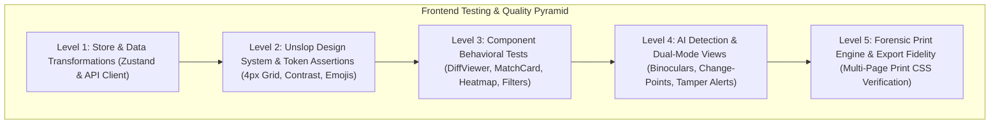

# Alethian v3.0: Frontend Testing & Evaluation Plan

**Document Version:** 3.0.0  
**Target Architecture:** React 19 + Vite 7 + Tailwind CSS v3 + Zustand v5 + Vitest  
**Methodology:** Eval-Driven Development (EDD) & Unslop Craft Verification

---

## 1. Executive Summary & Quality Gates

The Alethian v3.0 frontend transforms the cluttered, AI-bloated academic integrity interface into a clean, forensic-grade academic tool. To guarantee zero regressions, responsiveness, accessibility, and high forensic utility, the frontend testing suite enforces a **5-tier testing pyramid**:



### Quality Gate Pass Criteria:
1. **Vitest Unit & Component Suite:** 100% pass rate across all test suites (`npm test -- --run`).
2. **Zero-Emoji Assertion:** Lint and DOM query checks verify 0 decorative emojis across all interface labels.
3. **Tabular Numerals:** All percentage scores, word counts, and page numbers use `tabular-nums`.
4. **Print Pagination Gate:** Printing a 26-page forensic document prints all 26 pages without viewport cutoff.
5. **Color Contrast:** All text-to-background contrast ratios strictly meet WCAG 2.1 AA (minimum 4.5:1 for normal text, 3:1 for large headers).

---

## 2. Test Suite Specifications by Level

### Level 1: Zustand Store & API Layer (`src/tests/reportStore.test.js`, `src/tests/client.test.js`)
- **Store Initial State:**
  - Plagiarism state: `report`, `selectedMatchId`, `filterType`, `minSimilarity`, `searchTerm`.
  - AI Detection state: `aiDetectionResult`, `selectedWindowIndex`, `selectedTierFilter`, `tamperFlags`.
  - UI Mode state: `activeTab` ("plagiarism" | "ai_detection" | "forensic_split").
- **Action Verifications:**
  - `setReport(data)` properly normalizes both plagiarism matches and attached `ai_detection` payload.
  - `setAIDetection(data)` loads windows, risk classifications, and change-point markers.
  - `excludeMatch(matchId, reason)` updates local score recalculation optimistically.
  - `setActiveTab(tab)` switches viewport tabs cleanly.
- **API Client:**
  - Token handling: Bearer token injection in `Authorization` header.
  - Dual Serper/SerpApi admin configuration endpoints.
  - Real-time polling fallback for `/api/v1/ai-detection/{id}/status`.

### Level 2: Unslop Design System & Craft Assertions (`src/tests/UnslopCraft.test.jsx`)
- **Spacing Assertions:**
  - Verifies all margins, paddings, and gaps adhere to the 4px grid (no ad-hoc `mt-[13px]` or random padding).
  - Verifies equal elements share identical dimensions across lists and tables.
- **Color & Chrome Assertions:**
  - Verifies surfaces use the graphite neutral ramp (`#0d0e10`, `#141518`, `#1c1e22`, `#262930`).
  - Verifies chrome does not use hue gradients, neon glows, or radial blobs.
  - Verifies primary accent is quiet and single-purpose (`#3b82f6` or neutral off-white with dark text).
- **Typography & Copy Assertions:**
  - All section titles and labels use **Sentence case** (no screaming uppercase like `FORENSIC HEATMAP MATRIX`).
  - No exclamation marks (`!`) in system feedback or status banners.
  - Zero emojis in buttons, badges, and headers (e.g., replaces `✨ AI-Powered` with `Zero-shot statistical analysis`).

### Level 3: Component Behavioral Tests (`src/tests/ReportView.test.jsx`, `src/tests/Heatmap.test.jsx`, `src/tests/DiffViewer.test.jsx`)
- **`ScoreHeader.jsx`:**
  - Renders dual gauge metrics: Originality Score & AI Probability.
  - Renders document metadata (filename, author, total substantive word count, analyzed date).
  - Displays tamper alert badge when adversarial Unicode is detected.
- **`Heatmap.jsx` (Unslopped & Remediated):**
  - Displays per-page density tiles with subtle, non-overwhelming color scale:
    - Clean page ($<5\%$ match): Neutral slate (`#1c1e22` / light border)
    - Low match ($5\% - 25\%$): Subtle amber tint
    - High match ($>25\%$): Subdued coral tint (not 100% screaming neon red)
  - Clicking a page tile filters matches and scrolls the text overlay to that page.
- **`DiffViewer.jsx` / `TextOverlay.jsx`:**
  - Side-by-side comparison of submitted passage vs. source passage.
  - Highlighted word diffs using inline insertion/deletion styling.
  - Page-aware offset matching for accurate scrolling.

### Level 4: AI Detection & Dual-Mode Views (`src/tests/AIDetectionView.test.jsx`)
- **Evidentiary Tier Banners:**
  - Tier 0 (`T0_HUMAN`): Neutral calm green badge "Statistically consistent with human authorship".
  - Tier 1 (`T1_INDETERMINATE`): Amber badge "Indeterminate overlap zone".
  - Tier 2 (`T2_ELEVATED`): Orange badge "Mixed / partial AI generation detected".
  - Tier 3 (`T3_HIGH`): Coral badge "Elevated AI signal confirmed by Stage 2 audit".
  - Abstained (`ABSTAINED`): Information badge "Evaluation abstained (< 150 prose tokens)".
- **Change-Point Timeline & Paragraph Overlays:**
  - WCP+NOT transition markers clearly display where author style changes.
  - Paragraphs with elevated risk are visually outlined with clean hairlines and excerpt previews.
- **Tamper Alert Warning Drawer:**
  - Displays collapsible table of all normalized Cyrillic homoglyphs, zero-width spaces, and soft hyphens.

### Level 5: Forensic Print Engine & Multi-Page Export (`src/tests/PrintFidelity.test.jsx`)
- **Bug Root Cause Addressed:**
  - Current v2.0 UI encloses the document view in `h-screen overflow-hidden` and `overflow-y-auto`, causing `window.print()` to capture solely the first visible viewport screen.
- **Print CSS Rules Verified:**
  ```css
  @media print {
    body, #root, .app-shell, .content-container {
      overflow: visible !important;
      height: auto !important;
      max-height: none !important;
    }
    .no-print, header, nav, .sidebar, .action-toolbar {
      display: none !important;
    }
    .print-break-inside-avoid {
      break-inside: avoid;
      page-break-inside: avoid;
    }
    .print-page {
      break-after: page;
      page-break-after: always;
    }
  }
  ```
- **Export Menu & PDF Generation:**
  - Verifies multi-page jsPDF rendering captures all document pages and match annotations.
  - Verifies `window.print()` triggers clean printable stylesheet without chrome clipping.

---

## 3. Test Suite Matrix & File Manifest

| Test File | Target Component / Module | Assertions Count | Purpose |
|---|---|---|---|
| `src/tests/setup.js` | Vitest / Jest DOM environment | 1 | Global mock configs (resizeObserver, matchMedia, print) |
| `src/tests/client.test.js` | `src/api/client.js` | 3 | Axios token interceptor & error handling |
| `src/tests/reportStore.test.js` | `src/stores/reportStore.js` | 6 | Plagiarism & AI detection state synchronization |
| `src/tests/Login.test.jsx` | `src/pages/Login.jsx` | 3 | Unslopped login form & auth errors |
| `src/tests/Dashboard.test.jsx` | `src/pages/Dashboard.jsx` | 5 | Clean document table, filters, upload modal |
| `src/tests/ReportView.test.jsx` | `src/pages/ReportView.jsx` | 6 | Dual-mode tabs, scores, and match navigation |
| `src/tests/Heatmap.test.jsx` | `src/components/report/Heatmap.jsx` | 4 | Merged interval density, page selection |
| `src/tests/MatchCard.test.jsx` | `src/components/report/MatchCard.jsx` | 4 | Match metadata, exclusion, comments |
| `src/tests/DiffViewer.test.jsx` | `src/components/report/DiffViewer.jsx` | 4 | Side-by-side forensic text inspection |
| `src/tests/AIDetectionView.test.jsx` | `src/components/report/AIDetectionView.jsx` | 6 | Evidentiary tiers, change points, tamper alerts |
| `src/tests/ExportMenu.test.jsx` | `src/components/report/ExportMenu.jsx` | 4 | Multi-page print trigger & PDF download |
| `src/tests/UnslopCraft.test.jsx` | Global Design System & Components | 8 | 4px grid, 0 emojis, quiet chrome, tabular numbers |

---

## 4. Execution Workflow

```bash
# 1. Run full Vitest suite in single-run mode
npm test -- --run

# 2. Run with coverage
npm test -- --run --coverage

# 3. Check linting and formatting
npm run lint
```
