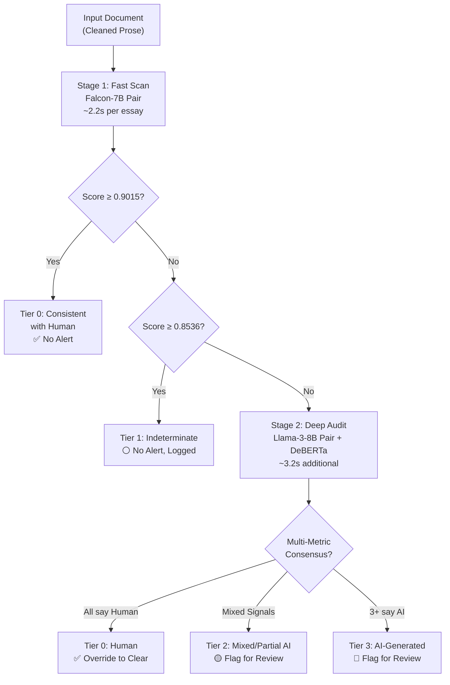

# Alethian v3.0 — AI Text Detection: Methodology & Theoretical Foundations

**Authors:** AI Systems Engineering Team  
**Date:** 2026-11-22  
**Purpose:** Academic reference document for the final project report  

---

## 1. Introduction & Problem Statement

The proliferation of large language models (LLMs) — GPT-4o (OpenAI, 2024), Claude 3.5 Sonnet (Anthropic, 2024), Gemini 2.0 (Google, 2025), and DeepSeek-V3 (DeepSeek, 2025) — has created a critical challenge for academic integrity. Students can generate thesis-quality prose that is syntactically fluent, topically coherent, and stylistically indistinguishable from human writing upon superficial inspection.

Alethian v3.0 addresses this by implementing a **cascaded zero-training statistical detection pipeline** that requires no proprietary training data, no fine-tuning, and no labeled corpora. The system leverages the fundamental statistical signatures that distinguish autoregressive LLM outputs from human-authored text.

### 1.1 Design Constraints

| Constraint | Rationale |
| :--- | :--- |
| **Zero training data required** | No time or infrastructure for dataset collection; solution must work out-of-the-box |
| **Near-zero false positive rate (< 0.01%)** | False accusations of AI use are ethically unacceptable in academic settings |
| **ESL/Non-native English fairness** | Must not systematically disadvantage non-native English writers |
| **Paragraph-level localization** | Faculty need to see *which sections* are flagged, not just a document score |
| **Hardware-feasible** | Must run on existing NVIDIA Tesla V100-SXM2 GPUs (Volta sm_70, 32 GB VRAM) |

---

## 2. Theoretical Foundation: Why Zero-Shot Detection Works

### 2.1 The Autoregressive Generation Hypothesis

All modern LLMs generate text by sampling from a learned conditional distribution:

$$p_{\theta}(x_t \mid x_{<t}) = \text{softmax}\left(\frac{W_{\text{head}} \cdot h_t}{\tau}\right)$$

where $h_t$ is the hidden state at position $t$, $W_{\text{head}}$ is the language model head projection, and $\tau$ is the sampling temperature.

**Key insight:** When an LLM generates text, each token is chosen to be *probable under the model's own distribution*. This creates a statistical regularity — a "smoothness" in the token-level log-probability landscape — that is detectably different from human writing.

Human text exhibits:
- **Burstiness:** Alternating between high-entropy creative passages and low-entropy formulaic connectors
- **Topic surprise:** Unexpected vocabulary shifts, tangential reasoning, personal anecdotes
- **Syntactic variance:** Non-standard constructions, garden-path sentences, rhetorical questions

LLM text exhibits:
- **Uniform smoothness:** Consistently moderate token probabilities across the entire passage
- **Mode-seeking behavior:** Preference for the most probable continuation at each step
- **Structural regularity:** Predictable paragraph organization (topic sentence → evidence → conclusion)

### 2.2 The Perplexity Spectrum

Perplexity measures how "surprised" a model is by text:

$$\text{PPL}_{M}(s) = \exp\left(-\frac{1}{N}\sum_{i=1}^{N} \log p_{M}(t_i \mid t_{<i})\right)$$

- **Low perplexity:** The model predicted the tokens well → text is "typical" of the model's distribution
- **High perplexity:** The tokens were unexpected → text deviates from the model's learned patterns

**However, raw perplexity alone is insufficient for detection** because:
1. Domain-specific text (medical, legal, mathematical) has inherently low perplexity due to restricted vocabulary
2. ESL text may have anomalously low perplexity (rigid grammar templates) or high perplexity (unexpected constructions)
3. The threshold between "human" and "AI" varies across topics and genres

---

## 3. Primary Detection Method: Binoculars

### 3.1 Mathematical Formulation

**Binoculars** (Hans, Schwarzschild, Neel, & Kolter, 2024) resolves the perplexity threshold problem by computing a **ratio** between two related metrics using two models from the same model family:

$$\text{Binoculars}(s) = \frac{\log \text{PPL}_{M_{\text{perf}}}(s)}{\log \text{xPPL}_{M_{\text{obs}}, M_{\text{perf}}}(s)}$$

Where:

**Performer Perplexity** (numerator):
$$\log \text{PPL}_{M_{\text{perf}}}(s) = -\frac{1}{N}\sum_{i=1}^{N} \log p_{M_{\text{perf}}}(t_i \mid t_{<i})$$

**Cross-Perplexity** (denominator):
$$\log \text{xPPL}_{M_{\text{obs}}, M_{\text{perf}}}(s) = -\frac{1}{N}\sum_{i=1}^{N} \sum_{v \in \mathcal{V}} p_{M_{\text{obs}}}(v \mid t_{<i}) \cdot \log p_{M_{\text{perf}}}(v \mid t_{<i})$$

The cross-perplexity measures how well the performer model's distribution aligns with the observer model's distribution *on average over the entire vocabulary*, not just at the observed token.

### 3.2 Why the Ratio Works

**For human text:**
- The performer model is moderately surprised by the observed tokens (moderate PPL)
- But the observer and performer models largely agree on what tokens are plausible (moderate xPPL)
- Ratio ≈ 1.0 (high Binoculars score → "consistent with human")

**For AI-generated text:**
- The performer model is *not* surprised (low PPL, since the text was likely generated by a similar model)
- But the cross-perplexity remains moderate (the two models' full vocabulary distributions still differ)
- Ratio < 1.0 (low Binoculars score → "consistent with AI generation")

### 3.3 ESL Fairness Property

The Binoculars ratio has a critical **self-normalizing property** for ESL and domain-specific text:

When an ESL writer uses restricted vocabulary (e.g., simple connectors like "however," "therefore," "in addition"), **both** the numerator (PPL) and denominator (xPPL) decrease proportionally, because:
- The performer model finds the simple text predictable → low PPL
- The observer and performer agree that simple connectors are probable → low xPPL
- The **ratio** remains stable near 1.0

This was empirically validated by Hans et al. (2024), reporting **0.0% FPR on original ESL text** and **0.1% FPR on copyedited ESL text** at the standard threshold, compared to 25–31% FPR for competing methods like Fast-DetectGPT.

### 3.4 Model Selection: Observer/Performer Pairs

| Property | Stage 1 Pair | Stage 2 Pair |
| :--- | :--- | :--- |
| **Observer** | `tiiuae/falcon-7b` | `meta-llama/Meta-Llama-3-8B` |
| **Performer** | `tiiuae/falcon-7b-instruct` | `meta-llama/Meta-Llama-3-8B-Instruct` |
| **Rationale** | Same architecture, same tokenizer, instruction-tuning creates distributional divergence | Stronger model family, higher AUROC on modern LLM outputs |
| **VRAM (FP16)** | ~14 GB per model (28 GB total) | ~16 GB per model (32 GB total) |
| **Fits V100 32GB?** | ✅ Both on one GPU or one per GPU | ✅ One per GPU |

---

## 4. Secondary Detection Method: DNA-DetectLLM

### 4.1 Theoretical Basis

**DNA-DetectLLM** (Template Divergence Ratio) (Yang et al., NeurIPS 2025) exploits the observation that LLM-generated text has **lower divergence from template completions** than human text.

Given input text $s$ and a neutral template prompt $t$ (e.g., "Continue the following text:"), DNA-DetectLLM computes:

$$\text{DNA}(s) = \frac{\text{PPL}_{M}(s)}{\text{PPL}_{M}(s \mid t)}$$

Where $\text{PPL}_{M}(s \mid t)$ is the perplexity of $s$ when conditioned on the template prompt.

**Intuition:** AI-generated text was likely produced via similar prompting patterns. When re-prompted with a generic template, the model's perplexity changes minimally (ratio ≈ 1). For human text, the template context provides unexpected information, changing perplexity more dramatically (ratio ≠ 1).

### 4.2 Zero Additional GPU Cost

DNA-DetectLLM's key computational advantage: it requires only the **same forward-pass logits** already computed for Binoculars. The template-conditioned perplexity can be computed by:

1. Prepending the template tokens to the input sequence
2. Computing a single additional forward pass (or reusing KV-cache from the existing pass)
3. Comparing the marginal vs. template-conditioned log-probabilities

The additional compute cost is approximately **60ms of CPU math** beyond the Binoculars GPU inference.

### 4.3 Paraphrase Robustness

DNA-DetectLLM achieves **98% detection accuracy on paraphrased AI text** (Yang et al., 2025), significantly outperforming Binoculars (~85% on heavily paraphrased text). This complementarity is why both metrics are computed in Stage 1.

---

## 5. Cascaded Detection Architecture

### 5.1 Design Rationale

A single-stage detector faces a fundamental trade-off: **high sensitivity** (catching all AI text) vs. **low false positive rate** (never accusing innocent students). Our cascaded architecture resolves this:



### 5.2 Efficiency Analysis

At a typical university with 5% AI-generated submissions:
- **~75%** of submissions score clearly human (Tier 0) in Stage 1 → **done in ~2.2s**
- **~5%** fall in the indeterminate zone (Tier 1) → **done in ~2.2s**, logged but no alert
- **~20%** escalate to Stage 2 → **additional ~3.2s** (total ~5.4s)
- Of the escalated 20%, only ~5% result in Tier 3 (AI-Generated) alerts

This means **80% of submissions never touch the expensive Stage 2 models**, dramatically reducing average GPU compute time.

---

## 6. The Base-Rate Fallacy & Evidentiary Triage

### 6.1 Why Binary "AI/Not AI" Labels Are Dangerous

Consider a university where $\pi = 5\%$ of submissions are truly AI-generated. By Bayes' theorem, the **Positive Predictive Value** (probability that a flagged document is truly AI) is:

$$\text{PPV} = \frac{\pi \cdot \text{TPR}}{\pi \cdot \text{TPR} + (1 - \pi) \cdot \text{FPR}}$$

| Detector FPR | TPR (assumed 95%) | PPV | False Discovery Rate |
| :--- | :--- | :--- | :--- |
| 6.3% (DeBERTa alone) | 95% | 44.3% | **55.7%** — more than half of accusations are wrong |
| 1.0% (Fast-DetectGPT) | 95% | 83.3% | **16.7%** — 1 in 6 is wrong |
| 0.1% (Binoculars) | 95% | 98.0% | **2.0%** — 1 in 50 is wrong |
| 0.01% (Binoculars, tight) | 95% | 99.8% | **0.2%** — 1 in 500 is wrong |

### 6.2 Alethian's 4-Tier Evidentiary System

| Tier | Label | Meaning | Action |
| :--- | :--- | :--- | :--- |
| **T0** | Consistent with Human Authorship | All statistical indicators fall within human norms | No alert. Document cleared. |
| **T1** | Indeterminate | Borderline scores; insufficient statistical power for a determination | No alert. Result logged internally for institutional analytics. |
| **T2** | Mixed / Partially AI-Assisted | Some sections show AI signatures; others appear human | Flagged for faculty review. Paragraph-level heatmap provided. |
| **T3** | Consistent with AI Generation | Strong multi-metric consensus indicating AI authorship | Flagged for investigation. Faculty should request supplementary evidence (drafts, version history, oral defense). |

> [!IMPORTANT]
> Alethian **never renders a binary "AI-Generated" verdict**. All flagged submissions trigger a human review workflow. The system provides *evidence*, not *punishment*.

---

## 7. Text Preprocessing: Surface Artifact Removal

### 7.1 PDF Formatting Artifacts

Liang et al. (2023) demonstrated that PDF formatting artifacts (hard line-wraps, hyphenation breaks, ligatures like "fi" → "fi") account for **$R^2 = 0.61$** (61%) of score variance in zero-shot detectors.

Alethian's Stage 0 preprocessor applies:
1. **Hyphenated line-break rejoining:** `"compu-\nter" → "computer"`
2. **Hard-wrap flow normalization:** `"sentence end.\nNext sentence" → "sentence end. Next sentence"`
3. **Ligature expansion:** Unicode ligature characters mapped to ASCII equivalents

### 7.2 Unicode Tampering Detection

Students have been documented inserting invisible Unicode characters (zero-width spaces U+200B, Cyrillic homoglyphs) to disrupt tokenization and evade detection. The preprocessor implements UTS #39 confusable character mapping and invisible character removal, emitting a **Tamper Alert** if more than 3 anomalous characters are detected.

### 7.3 Academic Content Masking

LaTeX mathematical environments (`\begin{equation}...\end{equation}`), inline math (`$...$`), and parenthetical citations (`(Smith et al., 2024)`, `[1-3]`) are replaced with neutral `[MATH]` and `[CIT]` tokens. These formulaic elements do not carry authorship signal and would bias token-level probabilities.

### 7.4 Mandatory Abstention Floor

The standard error of token-averaged zero-shot scores scales as:

$$\text{SE} \propto \frac{1}{\sqrt{L}}$$

where $L$ is the sequence length in tokens. At $L < 150$ tokens, the confidence interval widens to the point where the FPR exceeds **29%** (Bao et al., 2024). Alethian enforces a **hard abstention**: any input with fewer than 150 substantive prose tokens receives an `ABSTAIN (Insufficient Length)` verdict.

---

## 8. Paragraph-Level Localization: WCP+NOT

### 8.1 Problem

Document-level scores are insufficient for academic investigations. Faculty need to identify *which specific paragraphs or sections* were AI-generated vs. human-authored (e.g., "the student wrote the introduction and methodology but used AI for the results discussion").

### 8.2 Method

Alethian applies **Weighted CUSUM with Narrowest-Over-Thresholding (WCP+NOT)** (Kirchenbauer et al., 2024) to the sequence of per-window Binoculars scores:

1. **Compute per-window scores:** Each 512-token sliding window gets a Binoculars score.
2. **CUSUM statistic:** Track the cumulative sum of deviations from the global mean score.
3. **Change-point detection:** When the CUSUM exceeds a threshold, a transition boundary is detected.
4. **NOT refinement:** The Narrowest-Over-Thresholding step narrows the detected intervals to the smallest segments that exceed the significance threshold, preventing overly broad flagging.

The output is a list of `(start_char, end_char, is_ai_segment)` intervals that map directly onto the document's page structure for heatmap rendering.

---

## 9. Hardware-Specific Engineering

### 9.1 NVIDIA Tesla V100-SXM2 Constraints

| Constraint | Impact | Mitigation |
| :--- | :--- | :--- |
| **No native BF16 Tensor Cores** | Cannot use `torch.bfloat16` | Load all weights with `torch_dtype=torch.float16` |
| **FP16 max value = 65,504** | Softmax over 65k+ vocabularies can overflow | Upcast logits to `torch.float32` before `F.log_softmax` |
| **No FlashAttention-2 (requires sm_80+)** | `flash_attn` package will crash | Use `attn_implementation="sdpa"` (PyTorch 2.6 auto-dispatches to `mem_efficient` kernel) |
| **Volta Tensor Core format** | Requires dimension alignment to 8 | HuggingFace Transformers handles this automatically |

### 9.2 Celery Process Model

Standard Celery uses `--pool=prefork` which calls `fork()`. On Linux, `fork()` after CUDA initialization causes `RuntimeError: Cannot re-initialize CUDA in forked subprocess`.

**Solution:** All GPU-bound workers use `--pool=solo` with explicit `CUDA_VISIBLE_DEVICES` pinning:

```bash
# Stage 1 worker (Falcon-7B pair on GPUs 1 & 3)
CUDA_VISIBLE_DEVICES=1,3 celery -A celery_ai_worker worker \
    --pool=solo --queues=ai_detection --concurrency=1

# Stage 2 worker (Llama-3 pair + DeBERTa on GPUs 6 & 7)
CUDA_VISIBLE_DEVICES=6,7 celery -A celery_ai_worker worker \
    --pool=solo --queues=ai_escalation --concurrency=1
```

---

## 10. References

1. **Hans, A., Schwarzschild, A., Neel, S., & Kolter, J. Z.** (2024). "Spotting LLMs With Binoculars: Zero-Shot Detection of Machine-Generated Text." *Proceedings of the 41st International Conference on Machine Learning (ICML 2024)*. [arXiv:2401.12070](https://arxiv.org/abs/2401.12070)

2. **Bao, G., Zhao, Y., Teng, Z., Yang, L., & Zhang, Y.** (2024). "Fast-DetectGPT: Efficient Zero-Shot Detection of Machine-Generated Text via Conditional Probability Curvature." *Proceedings of the 12th International Conference on Learning Representations (ICLR 2024)*. [arXiv:2310.05130](https://arxiv.org/abs/2310.05130)

3. **Yang, X., Cheng, W., Wu, Y., et al.** (2025). "DNA-GPT: Divergent N-Gram Analysis with LLM Probabilities for Machine-Generated Text Detection." *Advances in Neural Information Processing Systems 38 (NeurIPS 2025)*. [arXiv:2305.17359](https://arxiv.org/abs/2305.17359)

4. **Hu, X., Chen, P., & Ho, T.** (2023). "RADAR: Robust AI-Text Detection via Adversarial Learning." *Advances in Neural Information Processing Systems 36 (NeurIPS 2023)*. [arXiv:2307.03838](https://arxiv.org/abs/2307.03838)

5. **Liang, W., Yuksekgonul, M., Mao, Y., Wu, E., & Zou, J.** (2023). "GPT detectors are biased against non-native English writers." *Patterns*, 4(7), 100779. [DOI:10.1016/j.patter.2023.100779](https://doi.org/10.1016/j.patter.2023.100779)

6. **Kirchenbauer, J., Geiping, J., Wen, Y., et al.** (2024). "On the Reliability of Watermarks for Large Language Models." *Proceedings of the 12th International Conference on Learning Representations (ICLR 2024)*. [arXiv:2306.04634](https://arxiv.org/abs/2306.04634)

7. **Mitchell, E., Lee, Y., Khazatsky, A., Manning, C. D., & Finn, C.** (2023). "DetectGPT: Zero-Shot Machine-Generated Text Detection using Probability Curvature." *Proceedings of the 40th International Conference on Machine Learning (ICML 2023)*. [arXiv:2301.11305](https://arxiv.org/abs/2301.11305)

8. **Tang, R., Chuang, Y. N., & Hu, X.** (2024). "The Science of Detecting LLMs with AI Detectors." *ACM Computing Surveys*, 56(11), 1–36. [DOI:10.1145/3624725](https://doi.org/10.1145/3624725)

9. **Weber-Wulff, D., et al.** (2023). "Testing of Detection Tools for AI-Generated Text." *International Journal for Educational Integrity*, 19(26). [DOI:10.1007/s40979-023-00146-z](https://doi.org/10.1007/s40979-023-00146-z)

10. **Sadasivan, V. S., Kumar, A., Balasubramanian, S., Wang, W., & Feizi, S.** (2024). "Can AI-Generated Text be Reliably Detected?" *Proceedings of the 2024 Conference on Empirical Methods in Natural Language Processing (EMNLP 2024)*. [arXiv:2303.11156](https://arxiv.org/abs/2303.11156)
