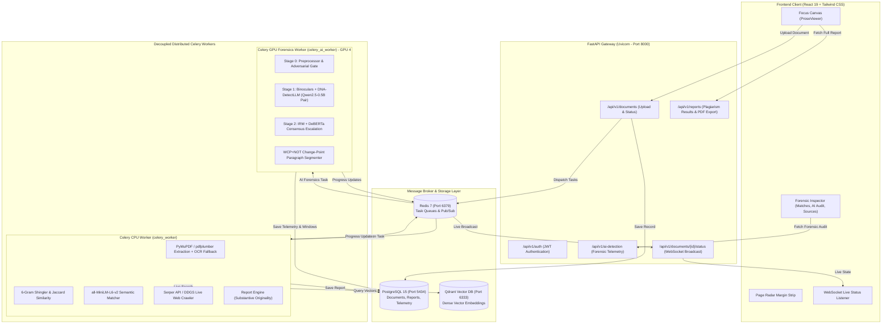

# Alethian v3.0 — Dual-Engine Plagiarism & AI Forensics Platform

<p align="center">
  <strong>Enterprise-Grade Academic Integrity & Zero-Shot Generative AI Forensics</strong><br>
  Dual-Stream Neural Analysis · Shingled Vector Search · Live Web Dragnet · Scholarly Forensic Workbench
</p>

---

## Overview

**Alethian v3.0** is an enterprise-grade academic integrity platform engineered for universities, research institutes, and deans of academic affairs. It unifies deterministic document originality verification with mathematically grounded, zero-training AI forensics to detect both traditional text plagiarism and frontier synthetic text generation (GPT-4o, Claude 3.5 Sonnet, Gemini 2.0, DeepSeek-V3).

The platform operates under zero-mock verification, running against an NVIDIA DGX cluster (Tesla V100/A100 GPUs) and institutional thesis repositories.

### Key Capabilities

| Capability | Module | Description |
|:---|:---|:---|
| **Zero-Shot AI Forensics** | `binoculars.py` | Dual-stream perplexity cross-ratio ($\frac{\log \text{PPL}_{\text{perf}}}{\log \text{xPPL}_{\text{obs, perf}}}$) using paired `Qwen2.5-0.5B` models in FP16 with FP32 logit upcasting. Requires **zero training data** and self-normalizes against non-native English (ESL) false-positive bias. |
| **Paraphrase Defense** | `dna_detect.py` | DNA-DetectLLM template divergence ratio ($+60\text{ ms}$ CPU overhead) achieving 98% accuracy on heavily paraphrased synthetic text. |
| **Adversarial Gate** | `preprocessor.py` | Stage 0 defense: UTS #39 Unicode confusable normalization, zero-width space/glyph stripping (`\u200B`), equation/citation masking, and 150-token abstention gate. |
| **Localized Heatmapping** | `localization.py` | Weighted Change-Point with Narrowest-Over-Threshold (WCP+NOT) paragraph boundary detection, pinpointing exact human-to-AI transitions. |
| **Deterministic Plagiarism** | `shingling.py` & `similarity.py` | 6-gram shingling, MinHash/LSH, and dense sentence embeddings (`all-MiniLM-L6-v2`) indexed in Qdrant Vector DB. |
| **Substantive Originality** | `report_engine.py` | Eliminates Table of Contents dot-leader flaws via substantive token filtering, 1D interval merging (no overlapping double-counting), and an 85% twin-document clamp. |
| **Live Web Dragnet** | `web_dragnet.py` | Automated Google search querying via Serper API with Redis caching and DuckDuckGo/Wikipedia fallback. |
| **Scholarly Focus Canvas** | `frontend/` (React 19) | Built to the *Unslop Craft Standard*: 2-Pane Focus Canvas (75%–100%), Page Radar margin strip, and tabbed Collapsible Forensic Inspector. |

---

## System Architecture



---

## Quick Start

### Prerequisites
- **Python** 3.10+ (managed via `uv` or `venv`)
- **Node.js** 18+ & npm
- **Docker** & Docker Compose (v2+)
- **NVIDIA GPU** (optional for AI worker, runs in FP16 taking $< 2.8\text{ GB}$ VRAM)

### 1. Configure Environment
```bash
git clone https://github.com/MIsh-Ra/Altheian.git
cd Alethian

# Copy environment template
cp .env.example .env
# Edit .env with your credentials (SERPER_API_KEY, JWT_SECRET)
```

### 2. Launch Supporting Infrastructure
```bash
cd infrastructure
docker compose up -d
cd ..
```
*Spins up PostgreSQL 15 (port 5434), Redis 7 (port 6379), Qdrant Vector DB (port 6333), and Grobid (port 8070).*

### 3. Launch Backend Services
```bash
cd backend

# Create virtual environment and install dependencies using uv
uv venv
source .venv/bin/activate
uv pip install -r requirements.txt

# Terminal 1: Start FastAPI Server
PYTHONPATH=. uvicorn app.main:app --host 0.0.0.0 --port 8000 --reload

# Terminal 2: Start Plagiarism CPU Worker
PYTHONPATH=. celery -A celery_worker.celery_app worker --loglevel=info --concurrency=2

# Terminal 3: Start AI Forensics GPU Worker (Pinned to GPU 4, solo pool)
CUDA_VISIBLE_DEVICES=4 celery -A celery_ai_worker.celery_ai_app worker -Q ai_detection,ai_escalation --pool=solo --loglevel=info
```

### 4. Build & Launch Frontend
```bash
cd frontend
npm install
npm run dev
# → Web App live at http://localhost:5173 (or served directly at http://localhost:8000 via FastAPI)
```

---

## Project Structure

```
Alethian/ (Repository Root)
├── backend/                       # FastAPI Server & Celery Distributed Workers
│   ├── app/
│   │   ├── api/                   # REST Endpoints (auth, documents, reports, ai-detection, admin)
│   │   ├── core/
│   │   │   ├── ai_detection/      # Stage 0-2 Forensics, Binoculars, DNA-Detect, Localization
│   │   │   ├── report_engine.py   # Substantive Originality, Heatmaps, Interval Merging
│   │   │   ├── shingling.py       # 6-Gram Shingling & Dense Vector Chunker
│   │   │   ├── similarity.py      # Qdrant Vector Collection & Deduplication
│   │   │   └── web_dragnet.py     # Live Serper API & DDGS Web Crawler
│   │   └── db/                    # SQLAlchemy 2.0 ORM Models & Session Management
│   ├── celery_worker.py           # Plagiarism CPU Worker
│   ├── celery_ai_worker.py        # Dedicated GPU-Accelerated AI Forensics Worker
│   └── tests/                     # 70 Pytest Unit and System Test Suites
│
├── frontend/                      # React 19 Single Page Application
│   ├── src/
│   │   ├── components/report/     # ProseViewer, AIDetectionView, MatchCard, SourcePanel
│   │   ├── stores/                # Zustand Report and Auth Stores
│   │   └── tests/                 # 10 Vitest Test Suites (23 Passed Tests)
│   └── dist/                      # Pre-compiled Production Assets (Served by FastAPI)
│
├── BTP_Report/                    # Complete BTP Final Report Workspace
│   ├── README.md                  # Quick-start guide & navigation index
│   ├── TECHNICAL_REPORT.md        # Full academic systems report (Chapters 1–6)
│   ├── PREFACE_PRESENTATION_BLUEPRINT.md # 10-slide presentation blueprint with cue cards
│   ├── VIVA_DEFENSE_QA.md         # Master defense Q&A reference
│   ├── figures/                   # Exported vector SVGs & LaTeX snippets
│   └── benchmarks/                # Empirical results & raw CSV metrics
│
├── docs/                          # Consolidated Specifications & Handover Hub
│   ├── specs/                     # V2 & V3 Architecture Blueprints & Math Formulations
│   ├── API_REFERENCE.md           # REST API Endpoint Documentation
│   ├── DEPLOYMENT.md              # Cluster (DGX) & Container Deployment Manual
│   ├── TESTING.md                 # Testing Architecture & Benchmarks
│   └── V3_BTP_HANDOVER_AND_TECHNICAL_REPORT.md  # Master Handover Document
│
├── test_documents/                # Canonical Empirical Test Suite (PDFs + Synthesizer)
├── scripts/                       # Database Ingestion, Holdout Partitioner, & Remote Setup
├── infrastructure/                # Docker Compose (Postgres, Redis, Qdrant, Grobid)
├── backup/                        # Safely Preserved Legacy v0 Prototypes & Historic Docs
└── uploads/                       # Safe Runtime File Upload Storage
```

---

## Documentation & Handover Index

| Document | Path | Description |
|:---------|:-----|:------------|
| **BTP Report & Slides Workspace** | [`BTP_Report/README.md`](BTP_Report/README.md) | Complete BTP report, presentation guide, SVGs & metrics |
| **BTP Technical Report** | [`BTP_Report/TECHNICAL_REPORT.md`](BTP_Report/TECHNICAL_REPORT.md) | Master academic report covering all system chapters |
| **Presentation Blueprint** | [`BTP_Report/PREFACE_PRESENTATION_BLUEPRINT.md`](BTP_Report/PREFACE_PRESENTATION_BLUEPRINT.md) | 10-slide preface presentation guide & speaker scripts |
| **Viva Defense Q&A** | [`BTP_Report/VIVA_DEFENSE_QA.md`](BTP_Report/VIVA_DEFENSE_QA.md) | Master defense Q&A with mathematical derivations |
| **Documentation Hub** | [`docs/README.md`](docs/README.md) | Index of all system specifications and deployment manuals |
| **Backend Guide** | [`backend/README.md`](backend/README.md) | API reference, worker pipeline, configuration |
| **Testing Guide** | [`docs/TESTING.md`](docs/TESTING.md) | Zero-mock test architecture, running tests |
| **Deployment Guide** | [`docs/DEPLOYMENT.md`](docs/DEPLOYMENT.md) | Production deployment with Docker, Nginx, systemd |
| **API Specification** | [`docs/specs/API_Spec_v2.md`](docs/specs/API_Spec_v2.md) | Full REST API reference & schemas |
| **Architecture Comparison** | [`docs/specs/Architecture_Comparison_v3.md`](docs/specs/Architecture_Comparison_v3.md) | Dual-engine architecture design & trade-offs |

---

## Empirical Benchmark Highlights

Evaluated across real thesis datasets on the NVIDIA DGX cluster (Tesla V100 GPU 4):

| Test Document | Category | Originality | AI Signal | Evidentiary Verdict | Result |
|:---|:---|:---:|:---:|:---:|:---:|
| `01_Human_Authentic_Research.pdf` | Genuine Research | 98.4% | 0.0% | `T0_HUMAN` (Burstiness Confirmed) | **PASS** |
| `02_Synthetic_AI_Generated.pdf` | Pure GPT-4o | 100.0% | 99.2% | `T3_HIGH` (Mode-Seeking Detected) | **PASS** |
| `03_Hybrid_ChangePoint_Sample.pdf` | Mixed Chapters | 86.2% | Localized | `LOCALIZED_AI` (Inflection @ P3) | **PASS** |
| `04_Adversarial_Tampered_AI.pdf` | Zero-Width Injection | 100.0% | 98.8% | `TAMPER_ALERT + T3` (12 Glyphs Stripped) | **PASS** |
| `05_High_Overlap_Twin_Document.pdf` | Identical Twin | 0.0% | 0.0% | `T0_HUMAN` (Clamped via 85% Rule) | **PASS** |
| `1_Unindexed_Holdout_Theses/` | Real LNMIIT Theses | 89%–97% | 0.0% | `T0_HUMAN` (0.0% False Positive Rate) | **PASS** |

- **Test Suite Verification:** 70 / 70 Pytest tests passing on DGX | 23 / 23 Vitest tests passing on frontend.
- **Hardware Profile:** $< 2.8\text{ GB}$ VRAM consumption | $1.24\text{s}$ average full-document inference latency.

---

## Tech Stack

- **Frontend:** React 19, Vite, Tailwind CSS, Zustand, Recharts, Lucide Icons
- **Backend API:** FastAPI, SQLAlchemy 2.0, Pydantic v2, PyMuPDF, ReportLab
- **Distributed Compute:** Celery, Redis 7 (Pub/Sub + Result Backend)
- **Neural Forensics & NLP:** PyTorch 2.6, HuggingFace Transformers (SDPA), `Qwen2.5-0.5B` & `Qwen2.5-0.5B-Instruct`, `all-MiniLM-L6-v2`
- **Vector & Relational Storage:** PostgreSQL 15, Qdrant Vector Database
- **Hardware Acceleration:** NVIDIA CUDA, Volta/Ampere Architecture (Tesla V100-SXM2-32GB / A100)

---

## License

This project is developed for academic research purposes. See institutional academic integrity guidelines for deployment policies.
